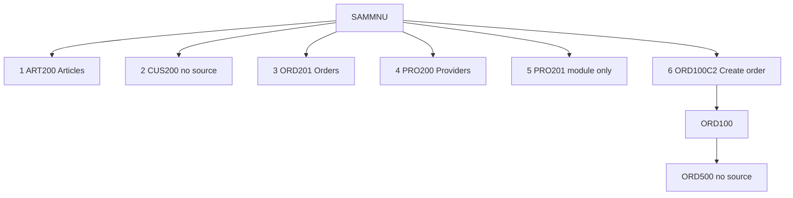

# Legacy IBM i application

This document describes the application in the open checkout. The git remote for this workspace is `https://github.com/ravalikanamburi-dev/legacy-tobi-example.git`. The project file `iproj.json` still records a different repository string, `https://github.com/edmundreinhardt/tobi-example.git`. Both strings are stored as written. Neither string, by itself, proves which library the programs run in.

Counts below come from a recursive walk of the working tree. The `.git` object store is one inventory row and is not expanded. Classification uses the file name and extension. A directory name is not treated as a language.

Line-level specifications for each program are linked at the end of this file. A statement here is **Confirmed** when a source line or build entry shows it, **Partially Confirmed** when it quotes a menu label or a comment, and **Unresolved** when the checkout does not contain the fact.

## What this repository is

`README.md` at the repository root says:

> Sample IBM i application with multiple source types using project metadata defined in iproj.json.
> Changed for COMMON Demo

`iproj.json` describes the project as "SAMPLE PROJECT" and names the license "Apache 2.0". The build command in that file is `/QOpenSys/pkgs/bin/makei build`.

The operator menu `QPNLSRC/SAMMNU-Main_menu_application_SAMPLE.MENUSRC` displays the title "Arcad Sample Application". The same member contains the line `(C) Copyright Arcad Software, 2016.` Some members, including `QDTASRC/LASTORDNO.DTAARA` and `QILESRC/PRO200.ILEPGM`, contain the comment "Source generated by ARCAD Software". Those lines are labels and comments. They are Partially Confirmed as text in the file. They are not proof of runtime behavior.

The checkout holds two kinds of source at once:

1. A menu-driven sample whose options name articles, customers, orders, providers, countries, and parameters.
2. A makei sample that also contains COBOL, C, C++, OPM RPG, SQL, globalization members, service programs, and two RPGUnit tests.

No job description, job schedule, user profile, or authority list is in the checkout. The library name used at build time is the substitution token `&lib1`. The concrete library name is Unresolved.

## What was counted

The first inventory walk counted **543** files, plus the `.git` directory. After the documentation files were added, the coverage script counted **548** files on disk and **549** inventory rows. The script reported no structural failures. Thirteen dependency rows remain open and are listed under [What the checkout does not contain](#what-the-checkout-does-not-contain).

Application source categories present:

| Category | Files |
| --- | --- |
| ILE RPG | 29 |
| ILE RPG with embedded SQL | 10 |
| OPM RPG | 6 |
| OPM RPG with embedded SQL | 1 |
| CLLE | 5 |
| CLP | 1 |
| COBOL | 4 |
| COBOL with embedded SQL | 2 |
| C | 2 |
| C with embedded SQL | 1 |
| C++ | 1 |
| C++ with embedded SQL | 1 |
| Physical files (DDS) | 12 |
| Logical files (DDS) | 13 |
| Display files | 18 |
| Printer files | 1 |
| Copy members | 13 |
| Binder source | 8 |
| Binding directory | 1 |
| SQL table | 2 |
| SQL view | 2 |
| SQL procedure | 1 |
| SQL function | 2 |
| SQL trigger | 1 |
| System triggers | 3 |
| Commands | 2 |
| Message files | 2 |
| Menu | 1 |
| Panel group | 1 |
| Data area | 1 |
| Data queue | 1 |

Build metadata is separate from those members: 26 `Rules.mk` files, `iproj.json`, and 14 `.ibmi.json` or editor-action files.

## How an operator enters

The only operator entry defined in this checkout is menu `SAMMNU`. Its instruction is "Select one of the following:". Options are grouped into Master files, Reports, and Utilities. Source: `QPNLSRC/SAMMNU-Main_menu_application_SAMPLE.MENUSRC`.

| Option | Menu label | What the menu runs | In this checkout |
| --- | --- | --- | --- |
| 1 | Work with Articles | `CALL ART200` | Program `ART200` |
| 2 | Work with Customers | `CALL CUS200` | No program source |
| 3 | Work with Customer Orders | `CALL ORD201` | Program `ORD201` |
| 4 | Work with Providers | `CALL pro200` | Program `PRO200` |
| 5 | Display Providers | `CALL pro201` | Module `PRO201` only. No `*PGM` target |
| 6 | Create a Customer Order. | `CALL ORD100C2` | Program `ORD100C2`, which calls `ORD100` |
| 10 | Article to purchase | `CALL pro203` | No program source |
| 11 | Customer with Open Order | `STRQMQRY QMQRY(CUSQRY) QMFORM(CUSQRYFMT)` | Query and form are not in the checkout |
| 12 | Article by Last Order Date | `STRQMQRY QMQRY(ARTQRY)` | Query is not in the checkout |
| 20 | Work with Parameters | `CALL par200` | Module `PAR200` only. No `*PGM` target |
| 21 | Work with countries | `CALL cou200` | Program `COU200` |
| 80 | Reset LASTORDNO | `CALL ord900` | Program `ORD900` |
| 81 | Reset Order dates to current | `CALL ord901` | Program `ORD901` |
| 82 | Reset Summary Fields | `CALL art801` | SQL procedure `ART801` |
| 83 | Work with IFS output | `CALL par201` | Program `PAR201` |
| 84 | Display Application log | `ADSPUSRSPC SAMLOG` | User space is not defined here |
| 90 | Signoff | `SIGNOFF` | IBM i command |

The diagram quotes the menu. An arrow means the menu source names that option. It does not prove the called program finishes.

## Create a customer order

This is the most complete path in the source. Menu option 6 calls `ORD100C2`.

`QCLSRC/ORD100C2.PGM.CLLE` does four things, in this order:

1. Deletes `QTEMP/DETORD` and monitors for `CPF0000`.
2. Creates a duplicate of file `DETORD` in `QTEMP` with no constraints and no triggers.
3. Overrides `TMPDETORD` to that `QTEMP` copy.
4. Calls program `ORD100`.

`QRPGLESRC/ORD100.PGM.RPGLE` is the ILE RPG program behind that call. Its control specification is `dftactgrp(*no) bnddir('SAMPLE')`. It declares:

| Declaration | Role written in the file specification |
| --- | --- |
| `order` | output disk file |
| `detord` | output keyed disk file |
| `Tmpdetord` | update and add, keyed, record renamed |
| `ord100d` | workstation file with a subfile |

The display file `QDDSSRC/ORD100D.DSPF` contains the literal "Create a Customer Order". The program copies prototypes `customer`, `article`, and `vat`. It references data area `LASTORDNO`. The data-area source stores the text "Last customer Order". It prototypes `ORD500` with `extpgm('ORD500')` at line 27. There is no source member for `ORD500`. What that call does is Unresolved. The same external prototype appears in `ORD101`, `ORD200`, and `ORD201`.

`ORD100` tests `panel` values `1` and `2`, and step values `prp`, `lod`, `dsp`, `key`, `chk`, and `act`. Those names belong to this member. A header comment says `ovrdbf tmpdetord detord` before compilation. The CL program above is the override the menu path runs. Subroutine names in the member are source order, not a proven execution trace. The specification page is [programs/rpg/ORD100.md](programs/rpg/ORD100.md).

A second entry exists and is not on the menu. `QCLSRC/ORD100C.PGM.CLLE` accepts a customer-id parameter, performs the same `QTEMP` setup, and runs the command `CRTORD`. `QCMDSRC/CRTORD.CMD` prompts "Create an Order" and accepts `CUID` (decimal, length 5, default 0, prompt "Customer Id."). The build rule for that command sets `CMD_PGM` to `ORD100`.

## Master files the menu can reach

**Articles.** Option 1 calls `ART200` (`QRPGLESRC/ART200-Work_with_article.PGM.SQLRPGLE`). The program uses display file `ART200D`, files `ARTICLE1` and `ARTICLE2`, and calls `ART201`. It binds directory `SAMPLE`.

**Customers.** Option 2 calls `CUS200`. No program target has that name. Display file `CUS200D` exists. That file is not proof that the menu runs it. Behavior of option 2 is Unresolved.

**Customer orders.** Option 3 calls `ORD201` (`QRPGLESRC/ORD201.PGM.SQLRPGLE`). The program uses display file `ORD201D` and files `ORDER1`, `CUSTOME1`, `ARTICLE1`, and `DETORD1`. It calls `ORD100C2`, `ORD101`, `ORD202`, and external program `ORD500`.

**Providers.** Option 4 calls `PRO200`, built from `QILESRC/PRO200.ILEPGM`. The object text on that script is "Work with Providers". The program is composed from module `PRO200` and service program `XML`. Option 5 calls `pro201`. The checkout builds `PRO201` as a COBOL module (`QCBLSRC/PRO201.CBLLE`) with display file `PRO201D`. There is no `PRO201` program target. That module copies names beginning `DDS-`. Those copybooks are not stored as members. Their origin is Unresolved.

## Reports and utilities

**Reports.** Option 10 calls `pro203`, which has no source here. Options 11 and 12 run Query Manager against `CUSQRY` and `ARTQRY`. Those query definitions are not in the checkout. The printer file `QDDSSRC/ORD500O.PRTF` exists. The menu actions do not name it.

**Parameters and countries.** Option 20 calls `par200`. The checkout builds module `PAR200`, which declares `PARAMETER` and display file `PAR200D`. There is no `PAR200` program target. Option 21 calls `COU200`, which is built with `COUNTRY` and display file `COU200D`.

**Reset programs.** Option 80 calls `ORD900`, which reads logical file `ORDER1` and data area `LASTORDNO`. Option 81 calls `ORD901`, which updates `ORDER` and runs SQL that sets an order-line year from the order header and sets `CUSTOMER.CULASTORD` from the maximum order date. The SQL text is Confirmed on [programs/rpg/ORD901.md](programs/rpg/ORD901.md). Option 82 calls `ART801`, the SQL procedure `UPDATE_ON_CUS_ORD_QTY` in `QSQLSRC/ART801.SQLPRC`. Its stored text is "Update Customer Order Quantity". The menu label for the same option is "Reset Summary Fields". Both strings are labels.

**IFS and the log.** Option 83 calls `PAR201`, a CL program built with service program `FPARAMETER`. Option 84 runs `ADSPUSRSPC SAMLOG`. This checkout does not define that user space.

## Data the programs share

Physical files live in `QDDSSRC` and are built by `QDDSSRC/Rules.mk`. Most of them reference the field-reference file `common/SAMREF.PF` with `REF(SAMREF)`. Field text below is the `TEXT` written in the DDS. A full field list is in [database/database-object-catalog.md](database/database-object-catalog.md) and [database/database-field-definitions.csv](database/database-field-definitions.csv).

| File | Record | What the DDS text says |
| --- | --- | --- |
| `CUSTOMER` | `FCUST` | Customer id and name, phone, VAT number, email, address, zip, city, country, credit limit, credit, last order date, creation and modification |
| `ORDER` | `FORDE` | Order id, year, customer id, order date, delivery date, close date |
| `DETORD` | `FDETO` | Order id, year, line, article id, ordered quantity, delivered quantity, unit price, line total, total with VAT |

`ARTICLE`, `PROVIDER`, `COUNTRY`, `FAMILLY`, `PARAMETER`, and `ARTIPROV` are further physical files in the same directory. Logical files such as `ORDER1`, `ARTICLE1`, and `CUSTOME1` are separate build targets. The key and the based-on file are on each object's section in the database catalog.

`TMPDETORD` is not a second DDS member. The RPG build rule creates it with `CPYF` from `DETORD`. The order-entry CL programs then point that name at a `QTEMP` copy for the duration of `ORD100`.

SQL objects in `QSQLSRC` include table `CUSTTBL`, views, sequence `CUSSEQ`, variable `valuse`, procedure `ART801`, and trigger `ORD701`. The SQL functions `ISOTODATE` and `ISOTODATE4` have source, and their service-program rules in `QSQLSRC/Rules.mk` are commented out, so they are not active build targets.

## How programs share code

ILE RPG programs that need shared procedures specify `bnddir('SAMPLE')`. The binding directory is `QBNDSRC/SAMPLE.BNDDIR`.

`QBNDSRC/Rules.mk` builds that directory from service programs `XML`, `TXT`, `FARTICLE`, `FCUSTOMER`, `FFAMILLY`, `FPARAMETER`, `FPROVIDER`, and `LOG`.

The binding-directory source also names `ORDER`, `XSS`, and `FVAT`. `FVAT` is built from `functionsVAT/fvat.bnd` and module `VAT300`. A service program named `ORDER` is not in the checkout. The file `ORDER` is. `XSS` exists as the prototype `QPROTOSRC/XSS.RPGLEINC` and not as a service-program target. Both lists are recorded. The checkout does not say which list is the one created on the system. Status: Partially Confirmed.

Copy members and prototypes are in `QPROTOSRC` and `includes`. `iproj.json` sets `includePath` to those two directories. `QPROTOSRC/APICALL-Prototypes_for_Ibm_API.RPGLEINC` prototypes IBM APIs `QUSCRTUS`, `QUSPTRUS`, and `QCMDEXC`. Their implementations are IBM-supplied programs, not members of this checkout.

RPGUnit tests exist for two procedures: `QTESTSRC/cus300.test.sqlrpgle` and `QTESTSRC/vat300.test.sqlrpgle`. `QTESTSRC` has no `Rules.mk`, and the root `Rules.mk` subdirectory list does not include it. A default `makei build` does not compile them. `iproj.json` places library `RPGUNIT` on the build library list. The RPGUnit product is not in this checkout.

## Other source in the same build

These objects are built, and the menu does not call them. They are part of the sample. Grouping them into one business process would be a guess, so they are listed by the kind of source they are.

| Area | Where | Examples |
| --- | --- | --- |
| COBOL | `QCBLSRC` | `VERIFY`, `VERIFYSQL`, `SMPL`, `PRO201` |
| C and C++ | `QCSRC`, `QCPPSRC`, `QSQLCSRC`, `QSQLCPPSRC` | `PUTIFS`, `PWD`, SQL C and SQL C++ members |
| CL | `QCLSRC` | `ORD100C`, `ORD100C2`, `ORD500C`, `PAR201`, `OPM` |
| OPM RPG | `QRPGSRC` | RPG members kept beside the ILE sources |
| Globalization | `globalization/CHS`, `DEU`, `HEB` | One program directory per `.ibmi.json` |
| Triggers | `QTRGSRC` | `ORD700A`, `ORD700D`, `ORD700U` |
| Help and messages | `QPNLSRC`, `QMSGSRC` | Panel group `SAMHELP`, message files `SAMMSGF` and `SGSMSGF` |
| Commands | `QCMDSRC` | `CRTORD`, `CVTSPLPDF` |

`globalization/DEU/Däöü.RPGLE` and `QSRVSRC/FARTICLE.BND` have no active build target. `FARTICLE` is built from `FARTICLE.ILESRVPGM` with `EXPORT(*ALL)`, so that binder listing is unused by the current rule.

`QTRGSRC/Rules.mk` exists, and the root `Rules.mk` subdirectory list does not include `QTRGSRC`. A default `makei build` does not build the order triggers. The trigger source is still in the checkout.

CCSID is taken from the nearest `.ibmi.json`. The project root uses 37. RPG, SQL, and prototype directories that carry their own file use 297. CL, COBOL, commands, and `functionsVAT` use 500. `globalization/CHS` uses 935, `globalization/DEU` uses 273, and `globalization/HEB` uses 424. No file in the checkout states which language a CCSID number represents.

## How a build runs

From the repository root, `iproj.json` runs `/QOpenSys/pkgs/bin/makei build`. The root `Rules.mk` builds these directories, in the order written there:

`QBNDSRC`, `QCBLSRC`, `QCLSRC`, `QCMDSRC`, `QDDSSRC`, `QDTASRC`, `QILESRC`, `QILESRVSRC`, `QMSGSRC`, `QPNLSRC`, `QRPGLESRC`, `QRPGSRC`, `QSQLSRC`, `QSRVSRC`, `QCSRC`, `QCPPSRC`, `QSQLCSRC`, `QSQLCPPSRC`, `common`, `functionsVAT`, `globalization`.

Each directory has its own `Rules.mk`. A file name such as `ART200-Work_with_article.PGM.SQLRPGLE` builds object `ART200` of type `*PGM`. The words after the hyphen are a description, not the object name.

Editor actions in `.vscode/actions.json` pass `lib1=&CURLIB` into makei. That is how a developer session supplies the value of `&lib1`. It is not a production library name stored in the repository. A second pair of actions points at `../ibmi-tobi/bin/makei`. That sibling path is not in this checkout.

## What the checkout does not contain

These names are written in source. Their implementations are not members here. Detail is in [dependencies/missing-dependencies.csv](dependencies/missing-dependencies.csv) and [final-review/unresolved-gaps-and-next-actions.md](final-review/unresolved-gaps-and-next-actions.md).

| Name | Where it is named | Status |
| --- | --- | --- |
| `ORD500` | `ORD100`, `ORD101`, `ORD200`, `ORD201` | Confirmed Missing |
| `CUS200` | Menu option 2 | Confirmed Missing |
| `pro203` | Menu option 10 | Confirmed Missing |
| `CUSQRY`, `CUSQRYFMT`, `ARTQRY` | Menu options 11 and 12 | Confirmed Missing |
| `SAMLOG` | Menu option 84 | Confirmed Missing |
| `DDS-FPROV` and six related `DDS-` copybooks | `QCBLSRC/PRO201.CBLLE` | Unresolved. Not stored as members |
| `&lib1` | `iproj.json` | Unresolved. Substitution token |
| `RPGUNIT`, `QDEVTOOLS` | `iproj.json` library list | External libraries named for the build |
| `QUSCRTUS`, `QUSPTRUS`, `QCMDEXC` | `QPROTOSRC/APICALL-Prototypes_for_Ibm_API.RPGLEINC` | IBM APIs. Prototypes only |

## Where the detailed pages are

Seventy-six program and build-script specifications are indexed in [programs/README.md](programs/README.md). Each page has identity, purpose, calls, files, processing statements, branches, SQL, error handling, dependencies, and the source path with line numbers. Database fields, relationships, and the program-to-file matrix are under [database/database-object-catalog.md](database/database-object-catalog.md).

| Topic | Page |
| --- | --- |
| File inventory | [inventory/source-file-inventory.md](inventory/source-file-inventory.md) |
| File-type counts | [inventory/file-type-summary.md](inventory/file-type-summary.md) |
| Business rules | [business-rules/business-rules-catalog.md](business-rules/business-rules-catalog.md) |
| Menu flow | [flows/application-functional-flows.md](flows/application-functional-flows.md) |
| Order-entry flow | [flows/program-processing-flows.md](flows/program-processing-flows.md) |
| Dependencies | [dependencies/dependency-validation-report.md](dependencies/dependency-validation-report.md) |
| Architecture | [architecture/application-architecture.md](architecture/application-architecture.md) |
| Build model | [architecture/build-and-execution-model.md](architecture/build-and-execution-model.md) |
| Coverage script result | [audit/coverage-validation-report.md](audit/coverage-validation-report.md) |
| Earlier narrative package | [application/README.md](application/README.md) |

The coverage script `scripts/validate_documentation_coverage.py` has been run against this checkout. It reported no broken documentation links and no missing program specifications. The thirteen open dependency rows remain, so this document does not claim that every program named by the menu has source here.
