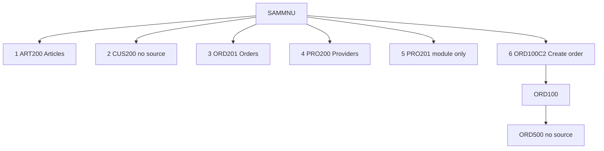

# Legacy IBM i application

This document describes the application in the open checkout. The git remote for this workspace is `https://github.com/ravalikanamburi-dev/legacy-tobi-example.git`. The project file `iproj.json` still records a different repository string, `https://github.com/edmundreinhardt/tobi-example.git`. Both strings are stored as written. Neither string, by itself, proves which library the programs run in.

Start a new machine with [knowledge-transfer/cursor-poc-user-guide.md](knowledge-transfer/cursor-poc-user-guide.md). It walks through installing Cursor, cloning this repository, opening the folder, and running the first-day checks. The technical handoff is [knowledge-transfer/cursor-poc-knowledge-transfer.md](knowledge-transfer/cursor-poc-knowledge-transfer.md). It records the documentation process, the COBOL-to-.NET slice, and the open items. The requests used so far are listed in [knowledge-transfer/cursor-poc-prompt-playbook.md](knowledge-transfer/cursor-poc-prompt-playbook.md). The reusable Agent prompt is [legacy-application-documentation-master-prompt.md](legacy-application-documentation-master-prompt.md). The findings from that prompt, written against this checkout, are in [Documentation and validation](#documentation-and-validation).

Counts below come from a recursive walk of the working tree. The `.git` object store is one inventory row and is not expanded. Classification uses the file name and extension. A directory name is not treated as a language.

Line-level specifications for each program are linked at the end of this file. A statement here is **Confirmed** when a source line or build entry shows it, **Partially Confirmed** when it quotes a menu label or a comment, and **Unresolved** when the checkout does not contain the fact.

## What this repository is

`README.md` at the repository root says:

> Sample IBM i application with multiple source types using project metadata defined in iproj.json.
> Changed for COMMON Demo

`iproj.json` describes the project as "SAMPLE PROJECT" and names the license "Apache 2.0". The build command in that file is `/QOpenSys/pkgs/bin/makei build`.

The operator menu `QPNLSRC/SAMMNU-Main_menu_application_SAMPLE.MENUSRC` displays the title "Arcad Sample Application". The same member contains the line `(C) Copyright Arcad Software, 2016.` Some members, including `QDTASRC/LASTORDNO.DTAARA` and `QILESRC/PRO200.ILEPGM`, contain the comment "Source generated by ARCAD Software". Those lines are labels and comments. They are Partially Confirmed as text in the file. They are not proof of runtime behavior.

The checkout holds two kinds of source at once:

1. A menu-driven sample whose options name articles, customers, orders, providers, countries, and parameters.
2. A makei sample that also contains COBOL, C, C++, OPM RPG, SQL, globalization members, service programs, and two RPGUnit tests.

No job description, job schedule, user profile, or authority list is in the checkout. The library name used at build time is the substitution token `&lib1`. The concrete library name is Unresolved.

## What was counted

The coverage script `scripts/validate_documentation_coverage.py` counted **610** files on disk. The `.git` object store is one extra inventory row, so the inventory has **611** rows. The script reported **0** structural failures. Tracker rows match the inventory: **600** Completed, **5** Partially Completed, **6** Not Applicable. The five partial rows are members that name a missing or unresolved dependency. Open dependency rows: **13**. They are listed under [What the checkout does not contain](#what-the-checkout-does-not-contain). This count includes the regenerated pages under `docs/application/` and the COBOL-to-.NET files under `dotnet/cobol-modernization/`.

Application source categories present:

| Category | Files |
| --- | --- |
| ILE RPG | 29 |
| ILE RPG with embedded SQL | 10 |
| OPM RPG | 6 |
| OPM RPG with embedded SQL | 1 |
| CLLE | 5 |
| CLP | 1 |
| COBOL | 4 |
| COBOL with embedded SQL | 2 |
| C | 2 |
| C with embedded SQL | 1 |
| C++ | 1 |
| C++ with embedded SQL | 1 |
| Physical files (DDS) | 12 |
| Logical files (DDS) | 13 |
| Display files | 18 |
| Printer files | 1 |
| Copy members | 13 |
| Binder source | 8 |
| Binding directory | 1 |
| SQL table | 2 |
| SQL view | 2 |
| SQL procedure | 1 |
| SQL function | 2 |
| SQL trigger | 1 |
| System triggers | 3 |
| Commands | 2 |
| Message files | 2 |
| Menu | 1 |
| Panel group | 1 |
| Data area | 1 |
| Data queue | 1 |

Build metadata is separate from those members: 26 `Rules.mk` files, `iproj.json`, and 14 `.ibmi.json` or editor-action files.

## How an operator enters

The only operator entry defined in this checkout is menu `SAMMNU`. Its instruction is "Select one of the following:". Options are grouped into Master files, Reports, and Utilities. Source: `QPNLSRC/SAMMNU-Main_menu_application_SAMPLE.MENUSRC`.

| Option | Menu label | What the menu runs | In this checkout |
| --- | --- | --- | --- |
| 1 | Work with Articles | `CALL ART200` | Program `ART200` |
| 2 | Work with Customers | `CALL CUS200` | No program source |
| 3 | Work with Customer Orders | `CALL ORD201` | Program `ORD201` |
| 4 | Work with Providers | `CALL pro200` | Program `PRO200` |
| 5 | Display Providers | `CALL pro201` | Module `PRO201` only. No `*PGM` target |
| 6 | Create a Customer Order. | `CALL ORD100C2` | Program `ORD100C2`, which calls `ORD100` |
| 10 | Article to purchase | `CALL pro203` | No program source |
| 11 | Customer with Open Order | `STRQMQRY QMQRY(CUSQRY) QMFORM(CUSQRYFMT)` | Query and form are not in the checkout |
| 12 | Article by Last Order Date | `STRQMQRY QMQRY(ARTQRY)` | Query is not in the checkout |
| 20 | Work with Parameters | `CALL par200` | Module `PAR200` only. No `*PGM` target |
| 21 | Work with countries | `CALL cou200` | Program `COU200` |
| 80 | Reset LASTORDNO | `CALL ord900` | Program `ORD900` |
| 81 | Reset Order dates to current | `CALL ord901` | Program `ORD901` |
| 82 | Reset Summary Fields | `CALL art801` | SQL procedure `ART801` |
| 83 | Work with IFS output | `CALL par201` | Program `PAR201` |
| 84 | Display Application log | `ADSPUSRSPC SAMLOG` | User space is not defined here |
| 90 | Signoff | `SIGNOFF` | IBM i command |



The diagram quotes the menu. An arrow means the menu source names that option. It does not prove the called program finishes.

## Create a customer order

This is the most complete path in the source. Menu option 6 calls `ORD100C2`.

`QCLSRC/ORD100C2.PGM.CLLE` does four things, in this order:

1. Deletes `QTEMP/DETORD` and monitors for `CPF0000`.
2. Creates a duplicate of file `DETORD` in `QTEMP` with no constraints and no triggers.
3. Overrides `TMPDETORD` to that `QTEMP` copy.
4. Calls program `ORD100`.

`QRPGLESRC/ORD100.PGM.RPGLE` is the ILE RPG program behind that call. Its control specification is `dftactgrp(*no) bnddir('SAMPLE')`. It declares:

| Declaration | Role written in the file specification |
| --- | --- |
| `order` | output disk file |
| `detord` | output keyed disk file |
| `Tmpdetord` | update and add, keyed, record renamed |
| `ord100d` | workstation file with a subfile |

The display file `QDDSSRC/ORD100D.DSPF` contains the literal "Create a Customer Order". The program copies prototypes `customer`, `article`, and `vat`. It references data area `LASTORDNO`. The data-area source stores the text "Last customer Order". It prototypes `ORD500` with `extpgm('ORD500')` at line 27. There is no source member for `ORD500`. What that call does is Unresolved. The same external prototype appears in `ORD101`, `ORD200`, and `ORD201`.

`ORD100` tests `panel` values `1` and `2`, and step values `prp`, `lod`, `dsp`, `key`, `chk`, and `act`. Those names belong to this member. A header comment says `ovrdbf tmpdetord detord` before compilation. The CL program above is the override the menu path runs. Subroutine names in the member are source order, not a proven execution trace. The specification page is [programs/rpg/ORD100.md](programs/rpg/ORD100.md).

A second entry exists and is not on the menu. `QCLSRC/ORD100C.PGM.CLLE` accepts a customer-id parameter, performs the same `QTEMP` setup, and runs the command `CRTORD`. `QCMDSRC/CRTORD.CMD` prompts "Create an Order" and accepts `CUID` (decimal, length 5, default 0, prompt "Customer Id."). The build rule for that command sets `CMD_PGM` to `ORD100`.

## Master files the menu can reach

**Articles.** Option 1 calls `ART200` (`QRPGLESRC/ART200-Work_with_article.PGM.SQLRPGLE`). The program uses display file `ART200D`, files `ARTICLE1` and `ARTICLE2`, and calls `ART201`. It binds directory `SAMPLE`.

**Customers.** Option 2 calls `CUS200`. No program target has that name. Display file `CUS200D` exists. That file is not proof that the menu runs it. Behavior of option 2 is Unresolved.

**Customer orders.** Option 3 calls `ORD201` (`QRPGLESRC/ORD201.PGM.SQLRPGLE`). The program uses display file `ORD201D` and files `ORDER1`, `CUSTOME1`, `ARTICLE1`, and `DETORD1`. It calls `ORD100C2`, `ORD101`, `ORD202`, and external program `ORD500`.

**Providers.** Option 4 calls `PRO200`, built from `QILESRC/PRO200.ILEPGM`. The object text on that script is "Work with Providers". The program is composed from module `PRO200` and service program `XML`. Option 5 calls `pro201`. The checkout builds `PRO201` as a COBOL module (`QCBLSRC/PRO201.CBLLE`) with display file `PRO201D`. There is no `PRO201` program target. That module copies names beginning `DDS-`. Those copybooks are not stored as members. Their origin is Unresolved.

## Reports and utilities

**Reports.** Option 10 calls `pro203`, which has no source here. Options 11 and 12 run Query Manager against `CUSQRY` and `ARTQRY`. Those query definitions are not in the checkout. The printer file `QDDSSRC/ORD500O.PRTF` exists. The menu actions do not name it.

**Parameters and countries.** Option 20 calls `par200`. The checkout builds module `PAR200`, which declares `PARAMETER` and display file `PAR200D`. There is no `PAR200` program target. Option 21 calls `COU200`, which is built with `COUNTRY` and display file `COU200D`.

**Reset programs.** Option 80 calls `ORD900`, which reads logical file `ORDER1` and data area `LASTORDNO`. Option 81 calls `ORD901`, which updates `ORDER` and runs SQL that sets an order-line year from the order header and sets `CUSTOMER.CULASTORD` from the maximum order date. The SQL text is Confirmed on [programs/rpg/ORD901.md](programs/rpg/ORD901.md). Option 82 calls `ART801`, the SQL procedure `UPDATE_ON_CUS_ORD_QTY` in `QSQLSRC/ART801.SQLPRC`. Its stored text is "Update Customer Order Quantity". The menu label for the same option is "Reset Summary Fields". Both strings are labels.

**IFS and the log.** Option 83 calls `PAR201`, a CL program built with service program `FPARAMETER`. Option 84 runs `ADSPUSRSPC SAMLOG`. This checkout does not define that user space.

## Data the programs share

Physical files live in `QDDSSRC` and are built by `QDDSSRC/Rules.mk`. Most of them reference the field-reference file `common/SAMREF.PF` with `REF(SAMREF)`. Field text below is the `TEXT` written in the DDS. A full field list is in [database/database-object-catalog.md](database/database-object-catalog.md) and [database/database-field-definitions.csv](database/database-field-definitions.csv).

| File | Record | What the DDS text says |
| --- | --- | --- |
| `CUSTOMER` | `FCUST` | Customer id and name, phone, VAT number, email, address, zip, city, country, credit limit, credit, last order date, creation and modification |
| `ORDER` | `FORDE` | Order id, year, customer id, order date, delivery date, close date |
| `DETORD` | `FDETO` | Order id, year, line, article id, ordered quantity, delivered quantity, unit price, line total, total with VAT |

`ARTICLE`, `PROVIDER`, `COUNTRY`, `FAMILLY`, `PARAMETER`, and `ARTIPROV` are further physical files in the same directory. Logical files such as `ORDER1`, `ARTICLE1`, and `CUSTOME1` are separate build targets. The key and the based-on file are on each object's section in the database catalog.

`TMPDETORD` is not a second DDS member. The RPG build rule creates it with `CPYF` from `DETORD`. The order-entry CL programs then point that name at a `QTEMP` copy for the duration of `ORD100`.

SQL objects in `QSQLSRC` include table `CUSTTBL`, views, sequence `CUSSEQ`, variable `valuse`, procedure `ART801`, and trigger `ORD701`. The SQL functions `ISOTODATE` and `ISOTODATE4` have source, and their service-program rules in `QSQLSRC/Rules.mk` are commented out, so they are not active build targets.

## How programs share code

ILE RPG programs that need shared procedures specify `bnddir('SAMPLE')`. The binding directory is `QBNDSRC/SAMPLE.BNDDIR`.

`QBNDSRC/SAMPLE.BNDDIR` is the create script. It runs `CRTBNDDIR` and `ADDBNDDIRE` for service programs `XML`, `ORDER`, `TXT`, `XSS`, `FARTICLE`, `FCUSTOMER`, `FFAMILLY`, `FPARAMETER`, `FPROVIDER`, `FVAT`, and `LOG`. That member is the binding list.

`QBNDSRC/Rules.mk` is the make prerequisite line for the same object: `XML`, `TXT`, `FARTICLE`, `FCUSTOMER`, `FFAMILLY`, `FPARAMETER`, `FPROVIDER`, and `LOG`. It does not replace the `ADDBNDDIRE` list. `FVAT` is built from `functionsVAT/fvat.bnd` and module `VAT300`, and that service program is not a prerequisite of `SAMPLE.BNDDIR`. A service program named `ORDER` is not in the checkout. The file `ORDER` is. `XSS` exists as the prototype `QPROTOSRC/XSS.RPGLEINC` and not as a service-program target.

Copy members and prototypes are in `QPROTOSRC` and `includes`. `iproj.json` sets `includePath` to those two directories. `QPROTOSRC/APICALL-Prototypes_for_Ibm_API.RPGLEINC` prototypes IBM APIs `QUSCRTUS`, `QUSPTRUS`, and `QCMDEXC`. Their implementations are IBM-supplied programs, not members of this checkout.

RPGUnit tests exist for two procedures: `QTESTSRC/cus300.test.sqlrpgle` and `QTESTSRC/vat300.test.sqlrpgle`. `QTESTSRC` has no `Rules.mk`, and the root `Rules.mk` subdirectory list does not include it. A default `makei build` does not compile them. `iproj.json` places library `RPGUNIT` on the build library list. The RPGUnit product is not in this checkout.

## Other source in the same build

These objects are built, and the menu does not call them. They are part of the sample. Grouping them into one business process would be a guess, so they are listed by the kind of source they are.

| Area | Where | Examples |
| --- | --- | --- |
| COBOL | `QCBLSRC` | `VERIFY`, `VERIFYSQL`, `SMPL`, `PRO201` |
| C and C++ | `QCSRC`, `QCPPSRC`, `QSQLCSRC`, `QSQLCPPSRC` | `PUTIFS`, `PWD`, SQL C and SQL C++ members |
| CL | `QCLSRC` | `ORD100C`, `ORD100C2`, `ORD500C`, `PAR201`, `OPM` |
| OPM RPG | `QRPGSRC` | RPG members kept beside the ILE sources |
| Globalization | `globalization/CHS`, `DEU`, `HEB` | One program directory per `.ibmi.json` |
| Triggers | `QTRGSRC` | `ORD700A`, `ORD700D`, `ORD700U` |
| Help and messages | `QPNLSRC`, `QMSGSRC` | Panel group `SAMHELP`, message files `SAMMSGF` and `SGSMSGF` |
| Commands | `QCMDSRC` | `CRTORD`, `CVTSPLPDF` |

`globalization/DEU/Däöü.RPGLE` and `QSRVSRC/FARTICLE.BND` have no active build target. `FARTICLE` is built from `FARTICLE.ILESRVPGM` with `EXPORT(*ALL)`, so that binder listing is unused by the current rule.

`QTRGSRC/Rules.mk` exists, and the root `Rules.mk` subdirectory list does not include `QTRGSRC`. A default `makei build` does not build the order triggers. The trigger source is still in the checkout.

CCSID is taken from the nearest `.ibmi.json`. The project root uses 37. RPG, SQL, and prototype directories that carry their own file use 297. CL, COBOL, commands, and `functionsVAT` use 500. `globalization/CHS` uses 935, `globalization/DEU` uses 273, and `globalization/HEB` uses 424. No file in the checkout states which language a CCSID number represents.

## How a build runs

From the repository root, `iproj.json` runs `/QOpenSys/pkgs/bin/makei build`. The root `Rules.mk` builds these directories, in the order written there:

`QBNDSRC`, `QCBLSRC`, `QCLSRC`, `QCMDSRC`, `QDDSSRC`, `QDTASRC`, `QILESRC`, `QILESRVSRC`, `QMSGSRC`, `QPNLSRC`, `QRPGLESRC`, `QRPGSRC`, `QSQLSRC`, `QSRVSRC`, `QCSRC`, `QCPPSRC`, `QSQLCSRC`, `QSQLCPPSRC`, `common`, `functionsVAT`, `globalization`.

Each directory has its own `Rules.mk`. A file name such as `ART200-Work_with_article.PGM.SQLRPGLE` builds object `ART200` of type `*PGM`. The words after the hyphen are a description, not the object name.

Editor actions in `.vscode/actions.json` pass `lib1=&CURLIB` into makei. That is how a developer session supplies the value of `&lib1`. It is not a production library name stored in the repository. A second pair of actions points at `../ibmi-tobi/bin/makei`. That sibling path is not in this checkout.

## What the checkout does not contain

These names are written in source. Their implementations are not members here. Detail is in [dependencies/missing-dependencies.csv](dependencies/missing-dependencies.csv) and [final-review/unresolved-gaps-and-next-actions.md](final-review/unresolved-gaps-and-next-actions.md).

| Name | Where it is named | Status |
| --- | --- | --- |
| `ORD500` | `ORD100`, `ORD101`, `ORD200`, `ORD201` | Confirmed Missing |
| `CUS200` | Menu option 2 | Confirmed Missing |
| `pro203` | Menu option 10 | Confirmed Missing |
| `CUSQRY`, `CUSQRYFMT`, `ARTQRY` | Menu options 11 and 12 | Confirmed Missing |
| `SAMLOG` | Menu option 84 | Confirmed Missing |
| `DDS-FPROV` and six related `DDS-` copybooks | `QCBLSRC/PRO201.CBLLE` | Unresolved. Not stored as members |
| `&lib1` | `iproj.json` | Unresolved. Substitution token |
| `RPGUNIT`, `QDEVTOOLS` | `iproj.json` library list | External libraries named for the build |
| `QUSCRTUS`, `QUSPTRUS`, `QCMDEXC` | `QPROTOSRC/APICALL-Prototypes_for_Ibm_API.RPGLEINC` | IBM APIs. Prototypes only |

## COBOL to .NET

The documentation supports a **COBOL slice**, not a rewrite of the RPG application. That slice is implemented under [`dotnet/cobol-modernization/`](../dotnet/cobol-modernization/README.md).

| COBOL | .NET |
| --- | --- |
| `QCBLSRC/PRO201.CBLLE` (menu option 5, Display Providers) | Web UI at `/Providers` |
| `QCBLSRC/verify.pgm.cblle` and the SQL COBOL verify members | `VerifyCobol` tests |
| `QCBLSRC/SMPL.CBL` | `SimpleCopybook` |

`CALL "ART202"` remains a boundary: ART202 is RPG and is not rewritten. Provider rows are in-memory sample data; this repository has no PROVIDER data members. RPG, CL, and the rest of `SAMMNU` are unchanged.

```bash
dotnet test dotnet/cobol-modernization/tests/Tobi.Cobol.Tests/Tobi.Cobol.Tests.csproj
dotnet run --project dotnet/cobol-modernization/src/Tobi.Cobol.Web/Tobi.Cobol.Web.csproj --urls http://127.0.0.1:5068
```

## Documentation and validation

This section is the evidence-based result of the documentation and validation prompt. It uses the pages already in this package. It does not replace them. A generated page is not proof that a rule or a dependency is correct. A finding below is traced to a source line, a build entry, or an explicit Unresolved mark.

No SME has signed these findings. Rows that need a subject-matter expert stay open.

### Source discovery

The inventory is [inventory/source-file-inventory.csv](inventory/source-file-inventory.csv). The coverage script reconciled it with the working tree: **611** inventory rows, **610** files on disk, **0** structural failures. Category totals are in [What was counted](#what-was-counted). Copybooks, screens, database files, service programs, binding directories, build scripts, tests, and CCSID files are included in that inventory. The concrete runtime library behind `&lib1` is not. Job descriptions, schedules, and user profiles are not in the checkout.

### Questions closed from this checkout

These questions can be answered from members that are already here. They do not need an SME.

**The `DDS-` names in `PRO201` point at files in this checkout.** `QCBLSRC/PRO201.CBLLE` copies `DDS-FPROV` in `PROVIDE1`, and copies `DDS-CTL01-O`, `DDS-CTL01-I`, `DDS-SFL01-O`, `DDS-SFL01-I`, `DDS-FMT02-O`, and `DDS-FMT02-I` in `PRO201D`. `QDDSSRC/PROVIDE1.LF` is a logical file over `PROVIDER` with record `FPROV`. `QDDSSRC/PRO201D.DSPF` contains formats `SFL01`, `CTL01`, and `FMT02`. The generated copybook text is not stored as its own member. The files and formats those copy statements name are in the tree.

**`ORD500C` and `ORD500O` are not program `ORD500`.** `QCLSRC/ORD500C.PGM.CLLE` accepts an order and a path, builds the stream-file name `Custord` plus that order plus `.pdf`, and runs `CVTSPLPDF` on printer file `ORD500O`. That explains the CL program and the printer file. It does not explain the external program call `ORD500`.

**`QTRGSRC` and `QTESTSRC` are outside the default build.** The root `Rules.mk` subdirectory list does not include them. `QTRGSRC/Rules.mk` exists, so `ORD700A`, `ORD700D`, and `ORD700U` are not compiled by a default `makei build`. `QTESTSRC` has two RPGUnit tests and no `Rules.mk`, so those tests are not compiled by that build either. `iproj.json` names library `RPGUNIT`. That product is not in this checkout.

**Compile CCSID for a program with no source member of its own comes from the manifest directory.** `CHS` uses `935` from `globalization/CHS/.ibmi.json`. `DEU` uses `273` from `globalization/DEU/.ibmi.json`. `PWD`, `PUTIFSCHK`, `ANZ_FILE`, `ANZ_FILE2`, and `TMPDETORD` have no nearer file, so they use `37` from the root `.ibmi.json`. `TMPDETORD` is created by `CPYF` and that recipe does not set a file CCSID. No file states which language a CCSID number represents.

**`QUSCRTUS`, `QUSPTRUS`, and `QCMDEXC` are IBM-supplied programs.** The prototypes are in `QPROTOSRC/APICALL-Prototypes_for_Ibm_API.RPGLEINC` and, for `QCMDEXC`, also in `QPROTOSRC/txt.rpgleinc`. The program bodies are not members of this checkout.

**`ISOTODATE.SRVPGM` and `ISOTODATE4.SRVPGM` are commented out.** `QSQLSRC/Rules.mk` prefixes both rules with `#`. The function members `ISOTODATE.SQLUDF` and `ISOTODATE4.SQLUDF` are still in the checkout. They are not active service-program targets.

**The binding directory member and its make rule are different lists.** `QBNDSRC/SAMPLE.BNDDIR` is the `ADDBNDDIRE` list. `QBNDSRC/Rules.mk` is the build-prerequisite list and omits `ORDER`, `XSS`, and `FVAT`. `ORDER` and `XSS` have no service-program target. `FVAT.SRVPGM` is built under `functionsVAT`.

### Questions that stay open

A name is Confirmed Missing when no member or `Rules.mk` target in this checkout matches it. That status does not prove the object is absent from an IBM i system. These rows stay open until the missing source is recovered or an SME confirms the object.

| Name | Referenced from | Business scenario | Status | Why it stays open |
| --- | --- | --- | --- | --- |
| `ORD500` | `ORD100` line 27, and the same external prototype in `ORD101`, `ORD200`, and `ORD201` | Create and work with customer orders | Confirmed Missing in this checkout | No program member. `ORD500C` and `ORD500O` are a different CL program and a printer file. |
| `CUS200` | Menu option 2 | Work with Customers | Confirmed Missing in this checkout | Only display file `CUS200D` is here. That file is not the program. |
| `pro203` | Menu option 10 | Article to purchase | Confirmed Missing in this checkout | No member with that name. |
| `CUSQRY`, `CUSQRYFMT` | Menu option 11 | Customer with Open Order | The `STRQMQRY` command is an IBM external. The query and form are absent here | The Query Manager definitions are not in the tree. |
| `ARTQRY` | Menu option 12 | Article by Last Order Date | The command is an IBM external. The query is absent here | The query definition is not in the tree. |
| `SAMLOG` | Menu option 84 | Display Application log | The `ADSPUSRSPC` command is an IBM external. The user space is absent here | No user-space source is in the checkout. |
| `&lib1` | `iproj.json` | Build | Unresolved | The repository has the token only. Editor actions pass `lib1=&CURLIB`. The production library name is not stored. |
| `makei build` result | `iproj.json` | Build | Unresolved | The command is stored. This pass did not run it. It needs an IBM i system. |
| SME sign-off | This package | All of the open rows | Not obtained | Cursor cannot sign for a subject-matter expert. |

The missing-name rows are also in [dependencies/missing-dependencies.csv](dependencies/missing-dependencies.csv) and [final-review/unresolved-gaps-and-next-actions.md](final-review/unresolved-gaps-and-next-actions.md).

### Build and runtime configuration

Confirmed from `iproj.json` and the root `Rules.mk`:

- The stored build command is `/QOpenSys/pkgs/bin/makei build`.
- The root subdirectory list includes `QBNDSRC` and does not include `QTRGSRC` or `QTESTSRC`.
- `QTRGSRC/Rules.mk` exists, so `ORD700A`, `ORD700D`, and `ORD700U` are outside a default build.
- `QTESTSRC` has two RPGUnit tests and no `Rules.mk`. A default build does not compile them. `iproj.json` names library `RPGUNIT`. That product is not in this checkout.
- CCSID comes from the nearest `.ibmi.json`. Root is 37. RPG, SQL, and prototype directories that carry their own file use 297. CL, COBOL, commands, and `functionsVAT` use 500. `globalization/CHS` uses 935, `globalization/DEU` uses 273, and `globalization/HEB` uses 424. The checkout does not state which language a CCSID number represents.

`QBNDSRC/SAMPLE.BNDDIR` is the `ADDBNDDIRE` list, including `ORDER`, `XSS`, and `FVAT`. `QBNDSRC/Rules.mk` is the shorter build-prerequisite list. `ORDER` and `XSS` have no service-program target in this checkout. `FVAT.SRVPGM` is built under `functionsVAT`.

This documentation pass did not run `makei build`. The build result on IBM i is Unresolved. The .NET tests under `dotnet/cobol-modernization/` check the COBOL slice only. They are not an IBM i build result.

### Dependency matrices

Statuses are Resolved, External Dependency, Dynamic Reference, Unresolved, and Confirmed Missing. The search behind those statuses is in [dependencies/dependency-validation-report.md](dependencies/dependency-validation-report.md).

| Matrix | Where | What a row is |
| --- | --- | --- |
| Caller to callee | [dependencies/dependency-inventory.csv](dependencies/dependency-inventory.csv) and [dependencies/dependency-diagrams.md](dependencies/dependency-diagrams.md) | A `CALL PGM` or `extpgm` name, with status. 131 dependency rows in the inventory |
| Program to copybook | The same inventory, kind copy or prototype | A copy or prototype name found in the member |
| Program to file | [database/program-data-access-matrix.csv](database/program-data-access-matrix.csv) | A file declaration or embedded SQL statement |
| Program to screen | Program specifications under [programs/README.md](programs/README.md), Files and interfaces | A workstation file named by the member |
| Program to service program or build target | [architecture/build-and-execution-model.md](architecture/build-and-execution-model.md) and `QBNDSRC` | A `bnddir` or `Rules.mk` target |

An arrow in a diagram means the source names that call. It does not prove the called program finishes.

### Business rules and scenarios

Rules are copied from menu actions and SQL statements. They are not renamed into a new business vocabulary. The catalog has 23 rows: [business-rules/business-rules-catalog.md](business-rules/business-rules-catalog.md). Menu text is Partially Confirmed. SQL text is Confirmed as the statement in the member.

Two scenarios have enough source to describe. Both still have open names.

**Create a customer order.** Menu option 6 calls `ORD100C2`, which prepares `QTEMP/DETORD` and calls `ORD100`. `ORD100` declares `order`, `detord`, `Tmpdetord`, and display file `ord100d`. It prototypes `ORD500`. What `ORD500` does is Unresolved. Detail is in [Create a customer order](#create-a-customer-order) and [flows/program-processing-flows.md](flows/program-processing-flows.md).

**Display providers.** Menu option 5 calls `pro201`. The checkout builds COBOL module `PRO201` with display file `PRO201D`. There is no `PRO201` program target. The `COPY DDS-` statements name `PROVIDE1` and `PRO201D`, and those files are in `QDDSSRC`. The generated copybook text is not stored as its own member. Option 5 in that module names `CALL "ART202"`. ART202 is RPG and is not part of the COBOL port. Detail is in [programs/cobol/PRO201.md](programs/cobol/PRO201.md).

### Cursor skills

The prompt names six responsibilities. This repository already has skills for them. A second set of skills with those six names was not added.

| Responsibility | Skill or tool already here |
| --- | --- |
| Discovery | `ibmi-source-inventory` and `.cursor/rules/ibmi-doc-discovery.mdc` |
| Dependency analysis | `ibmi-build-dependency-analysis` |
| Business-rule extraction | `ibmi-program-analysis`, `ibmi-data-definition-analysis`, and `ibmi-interface-analysis` |
| Documentation generation | `scripts/generate_legacy_docs.js` and `ibmi-app-documentation` for `docs/application/` |
| Validation | `scripts/validate_documentation_coverage.py` and `.cursor/rules/ibmi-doc-coverage.mdc` |
| Reporting | `docs/audit/`, `docs/final-review/`, and `docs/tracking/` |

`tobi-makei`, `tobi-rpgle`, and `tobi-rpgunit` are coding conventions. They are not evidence. This run did not change IBM i source, `Rules.mk`, `iproj.json`, or those coding skills.

### Skills execution

The documentation skills were run against this checkout. That run is complete.

| Step | Result |
| --- | --- |
| `ibmi-source-inventory` check | 352 files classified, 0 unclassified, 139 active build targets |
| `ibmi-app-documentation` | [application/README.md](application/README.md) regenerated: 187 object pages, 9 chapters, 9 open questions in [application/07-open-questions.md](application/07-open-questions.md) |
| `scripts/generate_legacy_docs.js` | 611 inventory rows, 76 program specifications, 23 business rules, 131 dependency rows, 13 missing-dependency rows, 814 database field or statement rows |
| `scripts/validate_documentation_coverage.py` | 0 structural failures. 610 files on disk. Tracker: 600 Completed, 5 Partially Completed, 6 Not Applicable |

Fourteen questions previously listed by the application package were closed from source in this run. The answers are under [Questions closed from this checkout](#questions-closed-from-this-checkout). Nine questions remain in [application/07-open-questions.md](application/07-open-questions.md): program `ORD500` at four call sites, `QTRGSRC` outside the default build, the concrete library name behind `&lib1`, program `CUS200`, program `pro203`, and the language name of each CCSID number. Query Manager objects, user space `SAMLOG`, the `makei build` result, the Excel workbook, and SME sign-off also stay open. They are in [Questions that stay open](#questions-that-stay-open).

### Excel workbook

No workbook was written. The checkout has no IBM i screen images, and this pass did not capture any. The .NET pages are not those screens. A workbook with invented screenshots would violate the validation rule, so the workbook is outstanding. The two scenarios above are the ones a later workbook can use, with the open names left open.

### Validation that ran

| Check | Result |
| --- | --- |
| `python scripts/validate_documentation_coverage.py` | 0 structural failures. 13 unresolved or missing dependency rows remain |
| Inventory matches the working tree | 611 rows, including `.git`. 610 files on disk |
| `makei build` | Not run. It needs an IBM i environment |
| Workbook compared to source | Skipped. No workbook exists |
| SME sign-off | Not obtained |

### Reports

| Report the prompt asks for | Page |
| --- | --- |
| Source inventory | [inventory/source-file-inventory.csv](inventory/source-file-inventory.csv) |
| Dependency matrices | [dependencies/dependency-inventory.csv](dependencies/dependency-inventory.csv) and [database/program-data-access-matrix.csv](database/program-data-access-matrix.csv) |
| Program and scenario documentation | [programs/README.md](programs/README.md), [flows/application-functional-flows.md](flows/application-functional-flows.md), [flows/program-processing-flows.md](flows/program-processing-flows.md) |
| Build and runtime analysis | [How a build runs](#how-a-build-runs) and [architecture/build-and-execution-model.md](architecture/build-and-execution-model.md) |
| Unresolved register | [dependencies/missing-dependencies.csv](dependencies/missing-dependencies.csv) |
| Coverage | [audit/coverage-validation-report.md](audit/coverage-validation-report.md) |
| Build and test readiness | [Build and runtime configuration](#build-and-runtime-configuration) |
| SME questions | [final-review/unresolved-gaps-and-next-actions.md](final-review/unresolved-gaps-and-next-actions.md) |
| Execution summary | [tracking/documentation-execution-summary.md](tracking/documentation-execution-summary.md) |
| Paste-ready prompt | [legacy-application-documentation-master-prompt.md](legacy-application-documentation-master-prompt.md) |

### Findings and limitations

The skills execution run is complete. Closed from this checkout: the menu and file layouts, the order-entry path through `ORD100`, the provider module `PRO201` and the files named by its `COPY DDS-` statements, the separate roles of `ORD500C` and `ORD500O`, compile CCSID for targets that have no source member of their own, the IBM prototypes for `QUSCRTUS`, `QUSPTRUS`, and `QCMDEXC`, the commented `ISOTODATE` service-program rules, the separate roles of `SAMPLE.BNDDIR` and `QBNDSRC/Rules.mk`, and the reason `QTRGSRC` and `QTESTSRC` are outside a default build.

Still open, and listed above: program `ORD500`, program `CUS200`, program `pro203`, the Query Manager objects, user space `SAMLOG`, the production library name, the language name of each CCSID number, and the result of `makei build`. No SME has signed this package. PDF output and an Excel workbook are not part of this delivery. Application source was not modified to produce these pages.

## Documentation package

These are the points required for this checkout. Each row names the file that holds that point and the result of the latest coverage run. A source fact the checkout does not contain stays Unresolved in the linked file. The same map is also in [audit/prompt-coverage.md](audit/prompt-coverage.md).

Latest run of `python scripts/validate_documentation_coverage.py`: **611** inventory rows, **610** files on disk, **76** program specifications, **23** business rules, **131** dependency rows, **13** unresolved or missing dependency rows, **814** database field or statement rows, **0** validation failures. PDF generation is outstanding. The Markdown package is the delivered form. The inventory includes `docs/application/` and the COBOL-to-.NET files under `dotnet/cobol-modernization/`.

### Repository inventory

Every file in the working tree has an inventory row. Columns are relative path, extension, category, size, documentation requirement, processing status, generated documentation path, and notes.

| Point | Page | Result |
| --- | --- | --- |
| Full inventory | [inventory/source-file-inventory.md](inventory/source-file-inventory.md) and [inventory/source-file-inventory.csv](inventory/source-file-inventory.csv) | Confirmed. 611 rows |
| Counting method and category totals | [inventory/file-type-summary.md](inventory/file-type-summary.md) | Confirmed |
| Binary and unparsed files | Inventory rows whose requirement is `not-applicable` | Confirmed. 6 tracker rows are Not Applicable |

### Existing documentation audit

`docs/application/` was regenerated by the skills execution run. It was not deleted.

| Point | Page | Result |
| --- | --- | --- |
| Review of README files and existing docs | [audit/existing-documentation-review.md](audit/existing-documentation-review.md) | Confirmed |
| Local link check | [audit/documentation-link-audit.csv](audit/documentation-link-audit.csv) | Confirmed. The coverage script reported no broken local links |
| Missing, empty, and incomplete pages | [audit/documentation-gaps.md](audit/documentation-gaps.md) | Confirmed |
| Application package | [application/README.md](application/README.md) | Regenerated. 187 object pages, 9 chapters, 9 open questions |

### Program specifications

There are **76** specifications, indexed in [programs/README.md](programs/README.md). The index groups them into `programs/rpg/`, `programs/cl/`, `programs/cobol/`, `programs/c/`, `programs/cpp/`, and `programs/other/`. DDS fields and keys are in the database catalog.

Each program page has these sections. A section that says Unresolved means that member did not contain that kind of statement.

| Point | Section |
| --- | --- |
| 1. Name and source path | Identity |
| 2. Purpose and business context | Purpose. Menu text and comments are Partially Confirmed |
| 3. Entry point, parameters, callers and callees | Entry and calls |
| 4. Inputs, outputs, files, and interfaces | Files and interfaces |
| 5. Processing steps | Processing logic. CL command order is the written order. RPG subroutine order is not an execution trace |
| 6. Branches | Business rules and branches |
| 7. Validations and calculations | Validations and calculations |
| 8. File and SQL modes | Data operations |
| 9. Errors, monitors, and messages | Error handling |
| 10. Calls, copies, prototypes, and data objects | Dependencies |
| 11. Changes to application data | Side effects |
| 12. Build or runtime assumptions | Build assumptions |
| 13. Path and line range | Traceability |
| 14. Confidence and open questions | Evidence status |

### Business rules and workflows

| Point | Page | Result |
| --- | --- | --- |
| Rules with unique IDs | [business-rules/business-rules-catalog.md](business-rules/business-rules-catalog.md) and [business-rules/business-rules-catalog.csv](business-rules/business-rules-catalog.csv) | Confirmed. 23 rules. Each row has condition, logic, outcome, objects, source location, and evidence status |
| Operator workflow from the menu | [flows/application-functional-flows.md](flows/application-functional-flows.md) | Partially Confirmed. The diagram quotes menu labels |
| Technical path for order entry | [flows/program-processing-flows.md](flows/program-processing-flows.md) | Confirmed through `ORD100`. `ORD500` is Unresolved |

### Database, DDS, and data mapping

| Point | Page | Result |
| --- | --- | --- |
| Physical files, logical files, display files, printer files, and SQL objects | [database/database-object-catalog.md](database/database-object-catalog.md) | Confirmed |
| Fields, lengths, text, and keys | [database/database-field-definitions.csv](database/database-field-definitions.csv) | Confirmed where the DDS writes them. Reference fields are Partially Confirmed. 814 field or statement rows |
| `REF`, `PFILE`, and `JFILE` relationships | [database/file-and-table-relationships.md](database/file-and-table-relationships.md) | Confirmed for extracted keywords |
| Programs that declare or change data | [database/program-data-access-matrix.csv](database/program-data-access-matrix.csv) | Confirmed for declarations and embedded SQL text |
| Input-to-output mappings | [database/data-mappings.md](database/data-mappings.md) | Confirmed only for SQL statements the source writes |

### Dependencies

A name that is not a filename was searched against object names, member stems, and `Rules.mk` targets before it was marked missing. Status values are Resolved, External Dependency, Dynamic Reference, Unresolved, and Confirmed Missing.

| Point | Page | Result |
| --- | --- | --- |
| Referenced name, file, location, type, evidence, and status | [dependencies/dependency-inventory.csv](dependencies/dependency-inventory.csv) | Confirmed. 131 rows |
| How each status was decided | [dependencies/dependency-validation-report.md](dependencies/dependency-validation-report.md) | Confirmed |
| Open names | [dependencies/missing-dependencies.csv](dependencies/missing-dependencies.csv) | 13 rows. Listed above |
| Call diagram | [dependencies/dependency-diagrams.md](dependencies/dependency-diagrams.md) | Confirmed for the edges named there |

### Architecture and build

| Point | Page | Result |
| --- | --- | --- |
| Application structure and entry points | This file and [architecture/application-architecture.md](architecture/application-architecture.md) | Confirmed from source and `Rules.mk` |
| Component catalog | [architecture/component-catalog.md](architecture/component-catalog.md) | Confirmed |
| External names and IBM-supplied interfaces | [architecture/integration-overview.md](architecture/integration-overview.md) | Confirmed as names. Their behavior outside this checkout is Unresolved |
| Build command, directory order, and CCSID files | [architecture/build-and-execution-model.md](architecture/build-and-execution-model.md) | Confirmed. Job schedules and user profiles are Unresolved |

### Tracker and later sessions

| Point | Page | Result |
| --- | --- | --- |
| Rule for later documentation sessions | [../.cursor/rules/legacy-documentation.mdc](../.cursor/rules/legacy-documentation.mdc) | Confirmed |
| One tracker row per inventoried file | [tracking/documentation-execution-tracker.csv](tracking/documentation-execution-tracker.csv) | Confirmed. 611 rows |
| Batch summary | [tracking/documentation-execution-summary.md](tracking/documentation-execution-summary.md) | Confirmed. 600 Completed, 5 Partially Completed, 6 Not Applicable |

### Coverage validation

| Point | Page | Result |
| --- | --- | --- |
| Repeatable check | [../scripts/validate_documentation_coverage.py](../scripts/validate_documentation_coverage.py) | Confirmed |
| Report | [audit/coverage-validation-report.md](audit/coverage-validation-report.md) | Passed. 0 failures |
| Result rows | [audit/coverage-validation-results.csv](audit/coverage-validation-results.csv) | Written by that run |

The script checks inventory disposition, program-specification headings, empty files, local Markdown links, source-path citations, tracker statuses, and the unresolved-dependency list. It returns a non-zero exit code when a structural check fails. Unresolved dependencies are reported and do not by themselves fail the run when they are listed in `missing-dependencies.csv`.

### Final review

| Point | Page | Result |
| --- | --- | --- |
| Quality review | [final-review/documentation-quality-review.md](final-review/documentation-quality-review.md) | Confirmed |
| Coverage counts | [final-review/final-coverage-summary.md](final-review/final-coverage-summary.md) | Counts in this README match the latest validation report |
| Remaining gaps and follow-up | [final-review/unresolved-gaps-and-next-actions.md](final-review/unresolved-gaps-and-next-actions.md) | 13 open dependency rows. PDF is not generated |
| Requirement-to-file map | [audit/prompt-coverage.md](audit/prompt-coverage.md) | Confirmed |

The thirteen open dependency rows remain, so this document does not claim that every program named by the menu has source here. Application source was not modified to produce these pages.
