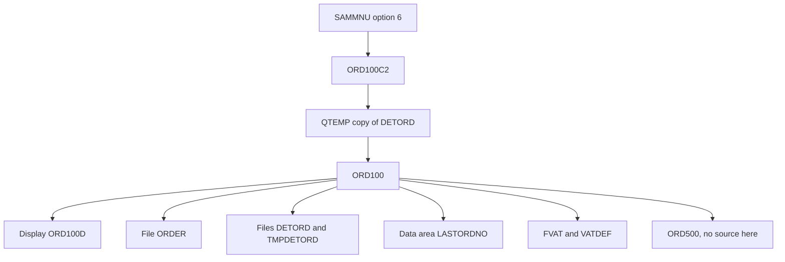

# tobi-example application guide

This guide explains what is in the repository and how the pieces fit together. It is written for a developer, a technical lead, and a solution architect. Every behavior below is taken from a source file. A description stored on an object, a comment, or a menu label is quoted as a label. Where the repository does not prove a fact, the text says NOT EVIDENCED and the same gap is listed in [07-open-questions.md](07-open-questions.md).

The object-by-object pages start at the [reference index](#reference-index) at the bottom of this file.

## What this repository is

`README.md` describes the repository in two lines:

> Sample IBM i application with multiple source types using project metadata defined in iproj.json.
> Changed for COMMON Demo

`iproj.json` names the project "SAMPLE PROJECT", sets the license to "Apache 2.0", and records the repository URL `https://github.com/edmundreinhardt/tobi-example.git`. The build command in that file is `/QOpenSys/pkgs/bin/makei build`.

The operator menu, `QPNLSRC/SAMMNU-Main_menu_application_SAMPLE.MENUSRC`, displays the title "Arcad Sample Application". The same member carries the line `(C) Copyright Arcad Software, 2016.` Some members, including `QDTASRC/LASTORDNO.DTAARA` and `QILESRC/PRO200.ILEPGM`, contain the comment "Source generated by ARCAD Software". Those lines are claims stored in the source. They do not, by themselves, describe runtime behavior.

Read the repository as two things at once:

1. A menu-driven sample with articles, customers, orders, providers, countries, and parameters.
2. A makei build sample that also contains COBOL, C, C++, OPM RPG, SQL, globalization members, service programs, and RPGUnit tests.

There is no job schedule, user profile, or authority list in the repository. The library name used at build time is the substitution token `&lib1` in `iproj.json`. The concrete library name is NOT EVIDENCED.

## How to read this package

| If you need | Start here |
| --- | --- |
| What the sample does and how a user reaches it | This guide, then [03-functional-areas.md](03-functional-areas.md) |
| One program, file, or screen | The reference index below, or [04-object-catalog.md](04-object-catalog.md) |
| Build order, libraries, and CCSID | [02-repository-and-build.md](02-repository-and-build.md) and [06-globalization.md](06-globalization.md) |
| What breaks if a file or service program changes | [05-dependencies.md](05-dependencies.md) |
| Facts the source does not prove | [07-open-questions.md](07-open-questions.md) |

## What the operator sees

The only operator entry point defined in this repository is the menu `SAMMNU`. Source: `QPNLSRC/SAMMNU-Main_menu_application_SAMPLE.MENUSRC`. The menu instruction is "Select one of the following:". Options are grouped into Master files, Reports, and Utilities. Option 90 runs `signoff`.

| Option | Menu label | What the menu runs | Where that name is defined |
| --- | --- | --- | --- |
| 1 | Work with Articles | `CALL ART200` | [ART200.PGM](programs/ART200-PGM.md) |
| 2 | Work with Customers | `CALL CUS200` | No program source in this repository |
| 3 | Work with Customer Orders | `CALL ORD201` | [ORD201.PGM](programs/ORD201-PGM.md) |
| 4 | Work with Providers | `CALL pro200` | [PRO200.PGM](programs/PRO200-PGM.md) |
| 5 | Display Providers | `CALL pro201` | Module only: [PRO201.MODULE](modules/PRO201-MODULE.md) |
| 6 | Create a Customer Order. | `CALL ORD100C2` | [ORD100C2.PGM](programs/ORD100C2-PGM.md) |
| 10 | Article to purchase | `CALL pro203` | No program source in this repository |
| 11 | Customer with Open Order | `STRQMQRY QMQRY(CUSQRY) QMFORM(CUSQRYFMT)` | Query and form are not in this repository |
| 12 | Article by Last Order Date | `STRQMQRY QMQRY(ARTQRY)` | Query is not in this repository |
| 20 | Work with Parameters | `CALL par200` | Module only: [PAR200.MODULE](modules/PAR200-MODULE.md) |
| 21 | Work with countries | `CALL cou200` | [COU200.PGM](programs/COU200-PGM.md) |
| 80 | Reset LASTORDNO | `CALL ord900` | [ORD900.PGM](programs/ORD900-PGM.md) |
| 81 | Reset Order dates to current | `CALL ord901` | [ORD901.PGM](programs/ORD901-PGM.md) |
| 82 | Reset Summary Fields | `CALL art801` | [ART801.PGM](programs/ART801-PGM.md) |
| 83 | Work with IFS output | `CALL par201` | [PAR201.PGM](programs/PAR201-PGM.md) |
| 84 | Display Application log | `ADSPUSRSPC SAMLOG` | The user space is not defined in this repository |
| 90 | Signoff | `SIGNOFF` | IBM i command, not an application program |

Options 5 and 20 resolve to modules. This repository does not contain a `*PGM` target named `PRO201` or `PAR200`.

## Create a customer order

This is the most complete path in the source. Menu option 6 calls `ORD100C2`.

`QCLSRC/ORD100C2.PGM.CLLE` does four things:

1. Deletes `QTEMP/DETORD` and monitors for `CPF0000`.
2. Creates a duplicate of file `DETORD` in `QTEMP` with no constraints and no triggers.
3. Overrides `TMPDETORD` to that `QTEMP` copy.
4. Calls program `ORD100`.

`QRPGLESRC/ORD100.PGM.RPGLE` is the ILE RPG program behind that call. Its control specification is `dftactgrp(*no) bnddir('SAMPLE')`. It declares:

- `ORDER` as an output disk file
- `DETORD` as an output keyed disk file
- `TMPDETORD` as an update/add keyed disk file
- `ORD100D` as the workstation file, with a subfile

The display file `QDDSSRC/ORD100D.DSPF` contains the literal "Create a Customer Order".

The program copies the prototypes `customer`, `article`, and `vat`. It references the data area `LASTORDNO`. The data-area source `QDTASRC/LASTORDNO.DTAARA` stores the text "Last customer Order". The program also calls `ORD500`. There is no source member for `ORD500` in this repository, so what that call does is NOT EVIDENCED. The same external call appears in `ORD101`, `ORD200`, and `ORD201`.

`ORD100` is written as a screen state machine. The member tests `panel` values `1` and `2`, and step values `prp`, `lod`, `dsp`, `key`, `chk`, and `act`. Those names belong to this member. A header comment says `ovrdbf tmpdetord detord` before compilation. The CL program above is the override that the menu path actually runs.

A second entry exists and is not on the menu. `QCLSRC/ORD100C.PGM.CLLE` accepts a customer-id parameter, performs the same `QTEMP` setup, and runs the command `CRTORD`. `QCMDSRC/CRTORD.CMD` prompts "Create an Order" and accepts `CUID` (decimal, length 5, default 0, prompt "Customer Id."). The build rule for that command sets `CMD_PGM` to `ORD100` (`QCMDSRC/Rules.mk`).

## Work with the master files

Each row is the menu label plus the files and calls that the called program's source declares.

**Articles.** Option 1 calls `ART200` (`QRPGLESRC/ART200-Work_with_article.PGM.SQLRPGLE`). The program uses display file `ART200D`, logical files `ARTICLE1` and `ARTICLE2`, and calls `ART201`. It binds the directory `SAMPLE`.

**Customers.** Option 2 calls `CUS200`. No program target has that name. A display file `CUS200D` exists. That file is not proof that the menu runs it. Behavior of option 2 is NOT EVIDENCED.

**Customer orders.** Option 3 calls `ORD201` (`QRPGLESRC/ORD201.PGM.SQLRPGLE`). The program uses display file `ORD201D` and files `ORDER1`, `CUSTOME1`, `ARTICLE1`, and `DETORD1`. It calls `ORD100C2`, `ORD101`, `ORD202`, and the external program `ORD500`.

**Providers.** Option 4 calls `PRO200`, built from `QILESRC/PRO200.ILEPGM`. The object text on that script is "Work with Providers". The program is composed from module `PRO200` and service program `XML`. Option 5 calls `pro201`. The repository builds `PRO201` as a COBOL module (`QCBLSRC/PRO201.CBLLE`) with display file `PRO201D`, and that module calls `ART202`. There is no `PRO201` program target.

## Reports and utilities on the menu

**Reports.** Option 10 calls `pro203`, which has no source here. Options 11 and 12 run Query Manager (`STRQMQRY`) against `CUSQRY` and `ARTQRY`. Those query definitions are not in the repository. The one printer file in the build is `ORD500O` (`QDDSSRC/ORD500O.PRTF`). It is not referenced by those menu actions.

**Parameters and countries.** Option 20 calls `par200`. The repository builds module `PAR200`, which declares `PARAMETER` and display file `PAR200D`. There is no `PAR200` program target. Option 21 calls `COU200`, which is built with `COUNTRY` and display file `COU200D`.

**Reset programs.** Option 80 calls `ORD900`, which reads logical file `ORDER1` and the data area `LASTORDNO`. Option 81 calls `ORD901`, which updates `ORDER` and runs SQL that sets order-line year from the order header and sets `CUSTOMER.CULASTORD` from the maximum `ORDATE`. Option 82 calls `ART801`. That object is the SQL procedure `UPDATE_ON_CUS_ORD_QTY` in `QSQLSRC/ART801.SQLPRC`. Its stored text is "Update Customer Order Quantity". The menu label for the same option is "Reset Summary Fields". Both strings are labels. The procedure body is on the [ART801](programs/ART801-PGM.md) page.

**IFS and the log.** Option 83 calls `PAR201`, a CL program built with service program `FPARAMETER`. Option 84 runs `ADSPUSRSPC SAMLOG`. This repository does not define that user space.

## Data the menu programs share

Physical files live in `QDDSSRC` and are built by `QDDSSRC/Rules.mk`. Most of them reference the field-reference file `SAMREF` (`common/SAMREF.PF`) with `REF(SAMREF)`. Field meanings below are the `TEXT` values written in the DDS.

| File | Record | What the DDS text says | Page |
| --- | --- | --- | --- |
| `CUSTOMER` | `FCUST` | Customer id and name, phone, VAT number, email, address lines, zip, city, country, credit limit, credit, last order date, creation and modification | [CUSTOMER.FILE](data-stores/CUSTOMER-FILE.md) |
| `ORDER` | `FORDE` | Order id, year, customer id, order date, delivery date, close date | [ORDER.FILE](data-stores/ORDER-FILE.md) |
| `DETORD` | `FDETO` | Order id, year, line, article id, ordered quantity, delivered quantity, unit price, line total, total line with VAT | [DETORD.FILE](data-stores/DETORD-FILE.md) |
| `LASTORDNO` | data area | Stored text: "Last customer Order" | [LASTORDNO.DTAARA](data-areas/LASTORDNO-DTAARA.md) |

`ARTICLE`, `PROVIDER`, `COUNTRY`, `FAMILLY`, `PARAMETER`, and `ARTIPROV` are further physical files in the same directory. Logical files such as `ORDER1`, `ARTICLE1`, and `CUSTOME1` are separate build targets. The key and the based-on file are on each data-store page.

`TMPDETORD` is not a second DDS member. `QRPGLESRC/Rules.mk` creates it with `CPYF` from `DETORD`. The order-entry CL programs then point that name at a `QTEMP` copy for the duration of `ORD100`.

SQL objects in `QSQLSRC` include table `CUSTTBL`, views, sequence `CUSSEQ`, variable `valuse`, procedure `ART801`, and trigger program `ORD701`. The SQL functions `ISOTODATE` and `ISOTODATE4` have source, and their service-program rules in `QSQLSRC/Rules.mk` are commented out, so they are not active build targets.

## How programs share code

ILE RPG programs that need shared procedures specify `bnddir('SAMPLE')`. The binding directory is `QBNDSRC/SAMPLE.BNDDIR`.

The build rule in `QBNDSRC/Rules.mk` lists these service programs: `XML`, `TXT`, `FARTICLE`, `FCUSTOMER`, `FFAMILLY`, `FPARAMETER`, `FPROVIDER`, and `LOG`.

The binding-directory source lists a different set, including `ORDER` and `XSS`. Both lists are recorded on [SAMPLE.BNDDIR](binding-directories/SAMPLE-BNDDIR.md). The repository does not say which list is the one created on the system. That disagreement is an open question.

Copy members and prototypes are in `QPROTOSRC` and `includes`. `iproj.json` sets `includePath` to those two directories. `QPROTOSRC/APICALL-Prototypes_for_Ibm_API.RPGLEINC` prototypes IBM APIs `QUSCRTUS`, `QUSPTRUS`, and `QCMDEXC`. Their implementations are not in this repository.

RPGUnit tests exist for two service procedures: `QTESTSRC/cus300.test.sqlrpgle` and `QTESTSRC/vat300.test.sqlrpgle`. `QTESTSRC` has no `Rules.mk`, and the root `Rules.mk` subdirectory list does not include it.

## What else is in the repository

These objects are built, and the menu does not call them. They are part of the sample. Grouping them into a business process would be a guess, so they are listed by the kind of source they demonstrate.

| Area | What the source is | Examples |
| --- | --- | --- |
| COBOL | Programs and modules in `QCBLSRC` | `VERIFY`, `VERIFYSQL`, `SMPL`, `PRO201` |
| C and C++ | `QCSRC`, `QCPPSRC`, `QSQLCSRC`, `QSQLCPPSRC` | `PUTIFS`, `PWD`, SQL C and SQL C++ programs |
| CL | Programs and one OPM CL member in `QCLSRC` | `ORD100C`, `ORD100C2`, `ORD500C`, `PAR201`, `OPM` |
| OPM RPG | Members in `QRPGSRC` | Older RPG programs kept beside the ILE sources |
| Globalization | One directory per CCSID file | `globalization/CHS` (CCSID 935), `globalization/DEU` (273), `globalization/HEB` (424) |
| Triggers | `QTRGSRC` | `ORD700A`, `ORD700D`, `ORD700U` |
| Help and messages | `QPNLSRC`, `QMSGSRC` | Panel group `SAMHELP`, message files `SAMMSGF` and `SGSMSGF` |
| Commands | `QCMDSRC` | `CRTORD`, `CVTSPLPDF` |

`globalization/DEU/Däöü.RPGLE` and `QSRVSRC/FARTICLE.BND` have no active build target. `FARTICLE` is built from `FARTICLE.ILESRVPGM` with `EXPORT(*ALL)`, so the binder listing is unused by the current rule.

`QTRGSRC/Rules.mk` exists, and the root `Rules.mk` subdirectory list does not include `QTRGSRC`. A default `makei build` does not build that directory. The trigger objects are still documented.

CCSID is taken from the nearest `.ibmi.json`. The project root uses 37. RPG, SQL, prototypes, and binder source under their own directories use 297. CL, COBOL, commands, and `functionsVAT` use 500. No file in the repository states which language a CCSID number represents.

## How a build runs

From the repository root, `iproj.json` runs `/QOpenSys/pkgs/bin/makei build`. The root `Rules.mk` builds these directories, in the order written there:

`QBNDSRC`, `QCBLSRC`, `QCLSRC`, `QCMDSRC`, `QDDSSRC`, `QDTASRC`, `QILESRC`, `QILESRVSRC`, `QMSGSRC`, `QPNLSRC`, `QRPGLESRC`, `QRPGSRC`, `QSQLSRC`, `QSRVSRC`, `QCSRC`, `QCPPSRC`, `QSQLCSRC`, `QSQLCPPSRC`, `common`, `functionsVAT`, `globalization`.

Each directory has its own `Rules.mk`. A file name such as `ART200-Work_with_article.PGM.SQLRPGLE` builds object `ART200` of type `*PGM`. The words after the hyphen are a description, not the object name.

Editor actions in `.vscode/actions.json` pass `lib1=&CURLIB` into makei. That is how a developer session supplies the value of `&lib1`. It is not a production library name stored in the repository.

## Facts the source leaves open

These are the gaps a lead should see before treating the sample as a complete application. Detail and file citations are in [07-open-questions.md](07-open-questions.md).

- Menu options `CUS200` and `pro203` have no program source.
- `ORD500` is called from the order programs and has no source.
- Query Manager queries `CUSQRY` and `ARTQRY`, and user space `SAMLOG`, are named on the menu and are not defined here.
- `SAMPLE.BNDDIR` source and its build rule list different service programs.
- The runtime library is the token `&lib1`.
- `QTRGSRC` is outside the default build.
- `ISOTODATE` and `ISOTODATE4` service programs are commented out in `QSQLSRC/Rules.mk`.

## Reference index

The tables below are the generated index of chapters and object pages. The explanation of the application is the guide at the top of this file. Where a page cannot prove a fact, it says NOT EVIDENCED.

Project text in `iproj.json`: "SAMPLE PROJECT". Repository field: `https://github.com/edmundreinhardt/tobi-example.git`.

## Chapters

| Chapter | Page |
| --- | --- |
| System overview | [01-system-overview.md](01-system-overview.md) |
| Repository and build | [02-repository-and-build.md](02-repository-and-build.md) |
| Functional areas | [03-functional-areas.md](03-functional-areas.md) |
| Object catalog | [04-object-catalog.md](04-object-catalog.md) |
| Dependencies | [05-dependencies.md](05-dependencies.md) |
| Globalization and CCSID | [06-globalization.md](06-globalization.md) |
| Open questions | [07-open-questions.md](07-open-questions.md) |
| Traceability | [08-traceability.md](08-traceability.md) |

## Object pages

| Section | Pages |
| --- | --- |
| binding-directories | 1 |
| commands | 2 |
| copy-members | 18 |
| data-areas | 1 |
| data-queues | 1 |
| data-stores | 32 |
| menus | 1 |
| messages | 2 |
| modules | 29 |
| panels | 1 |
| programs | 35 |
| reports | 1 |
| screens | 18 |
| service-programs | 11 |
| sql-routines | 2 |
| tests | 2 |
| triggers | 4 |
| unbound-source | 2 |
| workstation-customizing | 1 |

### binding-directories

| Object | Page |
| --- | --- |
| SAMPLE.BNDDIR | [binding-directories/SAMPLE-BNDDIR.md](binding-directories/SAMPLE-BNDDIR.md) |

### commands

| Object | Page |
| --- | --- |
| CRTORD.CMD | [commands/CRTORD-CMD.md](commands/CRTORD-CMD.md) |
| CVTSPLPDF.CMD | [commands/CVTSPLPDF-CMD.md](commands/CVTSPLPDF-CMD.md) |

### copy-members

| Object | Page |
| --- | --- |
| includes/included.clle | [copy-members/included-clle.md](copy-members/included-clle.md) |
| QPROTOSRC/APICALL-Prototypes_for_Ibm_API.RPGLEINC | [copy-members/APICALL-copy-member.md](copy-members/APICALL-copy-member.md) |
| QPROTOSRC/ARTICLE.RPGLEINC | [copy-members/ARTICLE-copy-member.md](copy-members/ARTICLE-copy-member.md) |
| QPROTOSRC/COUNTRY.RPGLEINC | [copy-members/COUNTRY-copy-member.md](copy-members/COUNTRY-copy-member.md) |
| QPROTOSRC/CPY01.RPGINC | [copy-members/CPY01-copy-member.md](copy-members/CPY01-copy-member.md) |
| QPROTOSRC/CPYBK1.RPG | [copy-members/CPYBK1-opm-rpg.md](copy-members/CPYBK1-opm-rpg.md) |
| QPROTOSRC/CPYBK2.RPG | [copy-members/CPYBK2-opm-rpg.md](copy-members/CPYBK2-opm-rpg.md) |
| QPROTOSRC/CUSTOMER.RPGLEINC | [copy-members/CUSTOMER-copy-member.md](copy-members/CUSTOMER-copy-member.md) |
| QPROTOSRC/DATACPY.CBL | [copy-members/DATACPY-cobol.md](copy-members/DATACPY-cobol.md) |
| QPROTOSRC/FAMILLY.RPGLEINC | [copy-members/FAMILLY-copy-member.md](copy-members/FAMILLY-copy-member.md) |
| QPROTOSRC/LOG_functions.RPGLEINC | [copy-members/LOG_functions-copy-member.md](copy-members/LOG_functions-copy-member.md) |
| QPROTOSRC/PARAMETER.RPGLEINC | [copy-members/PARAMETER-copy-member.md](copy-members/PARAMETER-copy-member.md) |
| QPROTOSRC/PROVIDER.RPGLEINC | [copy-members/PROVIDER-copy-member.md](copy-members/PROVIDER-copy-member.md) |
| QPROTOSRC/txt.rpgleinc | [copy-members/txt-copy-member.md](copy-members/txt-copy-member.md) |
| QPROTOSRC/VAR1.RPG | [copy-members/VAR1-opm-rpg.md](copy-members/VAR1-opm-rpg.md) |
| QPROTOSRC/VAT.RPGLEINC | [copy-members/VAT-copy-member.md](copy-members/VAT-copy-member.md) |
| QPROTOSRC/XML.RPGLEINC | [copy-members/XML-copy-member.md](copy-members/XML-copy-member.md) |
| QPROTOSRC/XSS.RPGLEINC | [copy-members/XSS-copy-member.md](copy-members/XSS-copy-member.md) |

### data-areas

| Object | Page |
| --- | --- |
| LASTORDNO.DTAARA | [data-areas/LASTORDNO-DTAARA.md](data-areas/LASTORDNO-DTAARA.md) |

### data-queues

| Object | Page |
| --- | --- |
| STREAMDTA.DTAQ | [data-queues/STREAMDTA-DTAQ.md](data-queues/STREAMDTA-DTAQ.md) |

### data-stores

| Object | Page |
| --- | --- |
| SAMREF.FILE | [data-stores/SAMREF-FILE.md](data-stores/SAMREF-FILE.md) |
| VATDEF.FILE | [data-stores/VATDEF-FILE.md](data-stores/VATDEF-FILE.md) |
| ARTICLE.FILE | [data-stores/ARTICLE-FILE.md](data-stores/ARTICLE-FILE.md) |
| ARTICLE1.FILE | [data-stores/ARTICLE1-FILE.md](data-stores/ARTICLE1-FILE.md) |
| ARTICLE2.FILE | [data-stores/ARTICLE2-FILE.md](data-stores/ARTICLE2-FILE.md) |
| CUSTOMER.FILE | [data-stores/CUSTOMER-FILE.md](data-stores/CUSTOMER-FILE.md) |
| CUSTOME1.FILE | [data-stores/CUSTOME1-FILE.md](data-stores/CUSTOME1-FILE.md) |
| CUSTOME2.FILE | [data-stores/CUSTOME2-FILE.md](data-stores/CUSTOME2-FILE.md) |
| COUNTRY.FILE | [data-stores/COUNTRY-FILE.md](data-stores/COUNTRY-FILE.md) |
| COUNTR1.FILE | [data-stores/COUNTR1-FILE.md](data-stores/COUNTR1-FILE.md) |
| ORDER.FILE | [data-stores/ORDER-FILE.md](data-stores/ORDER-FILE.md) |
| ORDER1.FILE | [data-stores/ORDER1-FILE.md](data-stores/ORDER1-FILE.md) |
| ORDER2.FILE | [data-stores/ORDER2-FILE.md](data-stores/ORDER2-FILE.md) |
| ORDER3.FILE | [data-stores/ORDER3-FILE.md](data-stores/ORDER3-FILE.md) |
| DETORD.FILE | [data-stores/DETORD-FILE.md](data-stores/DETORD-FILE.md) |
| DETORD1.FILE | [data-stores/DETORD1-FILE.md](data-stores/DETORD1-FILE.md) |
| TMPDETORD.FILE | [data-stores/TMPDETORD-FILE.md](data-stores/TMPDETORD-FILE.md) |
| FAMILLY.FILE | [data-stores/FAMILLY-FILE.md](data-stores/FAMILLY-FILE.md) |
| FAMILL1.FILE | [data-stores/FAMILL1-FILE.md](data-stores/FAMILL1-FILE.md) |
| PROVIDER.FILE | [data-stores/PROVIDER-FILE.md](data-stores/PROVIDER-FILE.md) |
| PROVIDE1.FILE | [data-stores/PROVIDE1-FILE.md](data-stores/PROVIDE1-FILE.md) |
| ARTIPROV.FILE | [data-stores/ARTIPROV-FILE.md](data-stores/ARTIPROV-FILE.md) |
| ARTIPRO1.FILE | [data-stores/ARTIPRO1-FILE.md](data-stores/ARTIPRO1-FILE.md) |
| PARAMETER.FILE | [data-stores/PARAMETER-FILE.md](data-stores/PARAMETER-FILE.md) |
| CUST.FILE | [data-stores/CUST-FILE.md](data-stores/CUST-FILE.md) |
| CUST1.FILE | [data-stores/CUST1-FILE.md](data-stores/CUST1-FILE.md) |
| ARTLSTDAT.FILE | [data-stores/ARTLSTDAT-FILE.md](data-stores/ARTLSTDAT-FILE.md) |
| ARTIINF.FILE | [data-stores/ARTIINF-FILE.md](data-stores/ARTIINF-FILE.md) |
| CUSSEQ.DTAARA | [data-stores/CUSSEQ-DTAARA.md](data-stores/CUSSEQ-DTAARA.md) |
| ORDERCUS.FILE | [data-stores/ORDERCUS-FILE.md](data-stores/ORDERCUS-FILE.md) |
| CUSTINFO1.FILE | [data-stores/CUSTINFO1-FILE.md](data-stores/CUSTINFO1-FILE.md) |
| CUSTTBL.FILE | [data-stores/CUSTTBL-FILE.md](data-stores/CUSTTBL-FILE.md) |

### menus

| Object | Page |
| --- | --- |
| SAMMNU.MENU | [menus/SAMMNU-MENU.md](menus/SAMMNU-MENU.md) |

### messages

| Object | Page |
| --- | --- |
| SAMMSGF.MSGF | [messages/SAMMSGF-MSGF.md](messages/SAMMSGF-MSGF.md) |
| SGSMSGF.MSGF | [messages/SGSMSGF-MSGF.md](messages/SGSMSGF-MSGF.md) |

### modules

| Object | Page |
| --- | --- |
| VAT300.MODULE | [modules/VAT300-MODULE.md](modules/VAT300-MODULE.md) |
| CHS.MODULE | [modules/CHS-MODULE.md](modules/CHS-MODULE.md) |
| DEU.MODULE | [modules/DEU-MODULE.md](modules/DEU-MODULE.md) |
| PRO201.MODULE | [modules/PRO201-MODULE.md](modules/PRO201-MODULE.md) |
| VERIFYSQL.MODULE | [modules/VERIFYSQL-MODULE.md](modules/VERIFYSQL-MODULE.md) |
| PAR201.MODULE | [modules/PAR201-MODULE.md](modules/PAR201-MODULE.md) |
| PWD.MODULE | [modules/PWD-MODULE.md](modules/PWD-MODULE.md) |
| PUTIFSCHK.MODULE | [modules/PUTIFSCHK-MODULE.md](modules/PUTIFSCHK-MODULE.md) |
| ART300.MODULE | [modules/ART300-MODULE.md](modules/ART300-MODULE.md) |
| ART301.MODULE | [modules/ART301-MODULE.md](modules/ART301-MODULE.md) |
| ART302.MODULE | [modules/ART302-MODULE.md](modules/ART302-MODULE.md) |
| COU300.MODULE | [modules/COU300-MODULE.md](modules/COU300-MODULE.md) |
| COU301.MODULE | [modules/COU301-MODULE.md](modules/COU301-MODULE.md) |
| CUS300.MODULE | [modules/CUS300-MODULE.md](modules/CUS300-MODULE.md) |
| CUS301.MODULE | [modules/CUS301-MODULE.md](modules/CUS301-MODULE.md) |
| DAT001.MODULE | [modules/DAT001-MODULE.md](modules/DAT001-MODULE.md) |
| DAT002.MODULE | [modules/DAT002-MODULE.md](modules/DAT002-MODULE.md) |
| FAM300.MODULE | [modules/FAM300-MODULE.md](modules/FAM300-MODULE.md) |
| FAM301.MODULE | [modules/FAM301-MODULE.md](modules/FAM301-MODULE.md) |
| LOG300.MODULE | [modules/LOG300-MODULE.md](modules/LOG300-MODULE.md) |
| PAR200.MODULE | [modules/PAR200-MODULE.md](modules/PAR200-MODULE.md) |
| PAR300.MODULE | [modules/PAR300-MODULE.md](modules/PAR300-MODULE.md) |
| PRO200.MODULE | [modules/PRO200-MODULE.md](modules/PRO200-MODULE.md) |
| PRO202.MODULE | [modules/PRO202-MODULE.md](modules/PRO202-MODULE.md) |
| PRO300.MODULE | [modules/PRO300-MODULE.md](modules/PRO300-MODULE.md) |
| XML001.MODULE | [modules/XML001-MODULE.md](modules/XML001-MODULE.md) |
| TXT001.MODULE | [modules/TXT001-MODULE.md](modules/TXT001-MODULE.md) |
| ANZ_FILE.MODULE | [modules/ANZ_FILE-MODULE.md](modules/ANZ_FILE-MODULE.md) |
| ANZ_FILE2.MODULE | [modules/ANZ_FILE2-MODULE.md](modules/ANZ_FILE2-MODULE.md) |

### panels

| Object | Page |
| --- | --- |
| SAMHELP.PNLGRP | [panels/SAMHELP-PNLGRP.md](panels/SAMHELP-PNLGRP.md) |

### programs

| Object | Page |
| --- | --- |
| CHS.PGM | [programs/CHS-PGM.md](programs/CHS-PGM.md) |
| DEU.PGM | [programs/DEU-PGM.md](programs/DEU-PGM.md) |
| HEB.PGM | [programs/HEB-PGM.md](programs/HEB-PGM.md) |
| VERIFY.PGM | [programs/VERIFY-PGM.md](programs/VERIFY-PGM.md) |
| VERIFYSQLP.PGM | [programs/VERIFYSQLP-PGM.md](programs/VERIFYSQLP-PGM.md) |
| SMPL.PGM | [programs/SMPL-PGM.md](programs/SMPL-PGM.md) |
| ORD100C.PGM | [programs/ORD100C-PGM.md](programs/ORD100C-PGM.md) |
| ORD100C2.PGM | [programs/ORD100C2-PGM.md](programs/ORD100C2-PGM.md) |
| ORD500C.PGM | [programs/ORD500C-PGM.md](programs/ORD500C-PGM.md) |
| OPM.PGM | [programs/OPM-PGM.md](programs/OPM-PGM.md) |
| PWD.PGM | [programs/PWD-PGM.md](programs/PWD-PGM.md) |
| PUTIFSCHK.PGM | [programs/PUTIFSCHK-PGM.md](programs/PUTIFSCHK-PGM.md) |
| PUTIFS.PGM | [programs/PUTIFS-PGM.md](programs/PUTIFS-PGM.md) |
| PRO200.PGM | [programs/PRO200-PGM.md](programs/PRO200-PGM.md) |
| PAR201.PGM | [programs/PAR201-PGM.md](programs/PAR201-PGM.md) |
| ART200.PGM | [programs/ART200-PGM.md](programs/ART200-PGM.md) |
| ART201.PGM | [programs/ART201-PGM.md](programs/ART201-PGM.md) |
| ART202.PGM | [programs/ART202-PGM.md](programs/ART202-PGM.md) |
| ADDNUM.PGM | [programs/ADDNUM-PGM.md](programs/ADDNUM-PGM.md) |
| LOG100.PGM | [programs/LOG100-PGM.md](programs/LOG100-PGM.md) |
| ORD100.PGM | [programs/ORD100-PGM.md](programs/ORD100-PGM.md) |
| ORD101.PGM | [programs/ORD101-PGM.md](programs/ORD101-PGM.md) |
| ORD200.PGM | [programs/ORD200-PGM.md](programs/ORD200-PGM.md) |
| ORD201.PGM | [programs/ORD201-PGM.md](programs/ORD201-PGM.md) |
| ORD202.PGM | [programs/ORD202-PGM.md](programs/ORD202-PGM.md) |
| ORD700.PGM | [programs/ORD700-PGM.md](programs/ORD700-PGM.md) |
| ORD900.PGM | [programs/ORD900-PGM.md](programs/ORD900-PGM.md) |
| ORD901.PGM | [programs/ORD901-PGM.md](programs/ORD901-PGM.md) |
| COU200.PGM | [programs/COU200-PGM.md](programs/COU200-PGM.md) |
| CSTNAME.PGM | [programs/CSTNAME-PGM.md](programs/CSTNAME-PGM.md) |
| CUSTINFO.PGM | [programs/CUSTINFO-PGM.md](programs/CUSTINFO-PGM.md) |
| ADDN.PGM | [programs/ADDN-PGM.md](programs/ADDN-PGM.md) |
| ANZ_FILE.PGM | [programs/ANZ_FILE-PGM.md](programs/ANZ_FILE-PGM.md) |
| ANZ_FILE2.PGM | [programs/ANZ_FILE2-PGM.md](programs/ANZ_FILE2-PGM.md) |
| ART801.PGM | [programs/ART801-PGM.md](programs/ART801-PGM.md) |

### reports

| Object | Page |
| --- | --- |
| ORD500O.FILE | [reports/ORD500O-FILE.md](reports/ORD500O-FILE.md) |

### screens

| Object | Page |
| --- | --- |
| ART200D.FILE | [screens/ART200D-FILE.md](screens/ART200D-FILE.md) |
| ART301D.FILE | [screens/ART301D-FILE.md](screens/ART301D-FILE.md) |
| CUS200D.FILE | [screens/CUS200D-FILE.md](screens/CUS200D-FILE.md) |
| CUS301D.FILE | [screens/CUS301D-FILE.md](screens/CUS301D-FILE.md) |
| COU200D.FILE | [screens/COU200D-FILE.md](screens/COU200D-FILE.md) |
| COU301D.FILE | [screens/COU301D-FILE.md](screens/COU301D-FILE.md) |
| ORD100D.FILE | [screens/ORD100D-FILE.md](screens/ORD100D-FILE.md) |
| ORD101D.FILE | [screens/ORD101D-FILE.md](screens/ORD101D-FILE.md) |
| ORD200D.FILE | [screens/ORD200D-FILE.md](screens/ORD200D-FILE.md) |
| ORD201D.FILE | [screens/ORD201D-FILE.md](screens/ORD201D-FILE.md) |
| ORD202D.FILE | [screens/ORD202D-FILE.md](screens/ORD202D-FILE.md) |
| FAM301D.FILE | [screens/FAM301D-FILE.md](screens/FAM301D-FILE.md) |
| PRO200D.FILE | [screens/PRO200D-FILE.md](screens/PRO200D-FILE.md) |
| PRO201D.FILE | [screens/PRO201D-FILE.md](screens/PRO201D-FILE.md) |
| ART201D.FILE | [screens/ART201D-FILE.md](screens/ART201D-FILE.md) |
| ART202D.FILE | [screens/ART202D-FILE.md](screens/ART202D-FILE.md) |
| PRO202D.FILE | [screens/PRO202D-FILE.md](screens/PRO202D-FILE.md) |
| PAR200D.FILE | [screens/PAR200D-FILE.md](screens/PAR200D-FILE.md) |

### service-programs

| Object | Page |
| --- | --- |
| FVAT.SRVPGM | [service-programs/FVAT-SRVPGM.md](service-programs/FVAT-SRVPGM.md) |
| FARTICLE.SRVPGM | [service-programs/FARTICLE-SRVPGM.md](service-programs/FARTICLE-SRVPGM.md) |
| FPARAMETER.SRVPGM | [service-programs/FPARAMETER-SRVPGM.md](service-programs/FPARAMETER-SRVPGM.md) |
| LOG.SRVPGM | [service-programs/LOG-SRVPGM.md](service-programs/LOG-SRVPGM.md) |
| VALUSE.SRVPGM | [service-programs/VALUSE-SRVPGM.md](service-programs/VALUSE-SRVPGM.md) |
| FCOUNTRY.SRVPGM | [service-programs/FCOUNTRY-SRVPGM.md](service-programs/FCOUNTRY-SRVPGM.md) |
| FCUSTOMER.SRVPGM | [service-programs/FCUSTOMER-SRVPGM.md](service-programs/FCUSTOMER-SRVPGM.md) |
| FFAMILLY.SRVPGM | [service-programs/FFAMILLY-SRVPGM.md](service-programs/FFAMILLY-SRVPGM.md) |
| FPROVIDER.SRVPGM | [service-programs/FPROVIDER-SRVPGM.md](service-programs/FPROVIDER-SRVPGM.md) |
| TXT.SRVPGM | [service-programs/TXT-SRVPGM.md](service-programs/TXT-SRVPGM.md) |
| XML.SRVPGM | [service-programs/XML-SRVPGM.md](service-programs/XML-SRVPGM.md) |

### sql-routines

| Object | Page |
| --- | --- |
| QSQLSRC/ISOTODATE.SQLUDF | [sql-routines/ISOTODATE-sql-function.md](sql-routines/ISOTODATE-sql-function.md) |
| QSQLSRC/ISOTODATE4.SQLUDF | [sql-routines/ISOTODATE4-sql-function.md](sql-routines/ISOTODATE4-sql-function.md) |

### tests

| Object | Page |
| --- | --- |
| QTESTSRC/cus300.test.sqlrpgle | [tests/cus300.test-ile-rpg-sql.md](tests/cus300.test-ile-rpg-sql.md) |
| QTESTSRC/vat300.test.sqlrpgle | [tests/vat300.test-ile-rpg-sql.md](tests/vat300.test-ile-rpg-sql.md) |

### triggers

| Object | Page |
| --- | --- |
| ORD701.PGM | [triggers/ORD701-PGM.md](triggers/ORD701-PGM.md) |
| ORD700A.TRG | [triggers/ORD700A-TRG.md](triggers/ORD700A-TRG.md) |
| ORD700D.TRG | [triggers/ORD700D-TRG.md](triggers/ORD700D-TRG.md) |
| ORD700U.TRG | [triggers/ORD700U-TRG.md](triggers/ORD700U-TRG.md) |

### unbound-source

| Object | Page |
| --- | --- |
| globalization/DEU/Däöü.RPGLE | [unbound-source/Däöü-ile-rpg.md](unbound-source/Däöü-ile-rpg.md) |
| QSRVSRC/FARTICLE.BND | [unbound-source/FARTICLE-binder-source.md](unbound-source/FARTICLE-binder-source.md) |

### workstation-customizing

| Object | Page |
| --- | --- |
| QPNLSRC/wstrig.wscstsrc | [workstation-customizing/wstrig-workstation-customizing.md](workstation-customizing/wstrig-workstation-customizing.md) |

