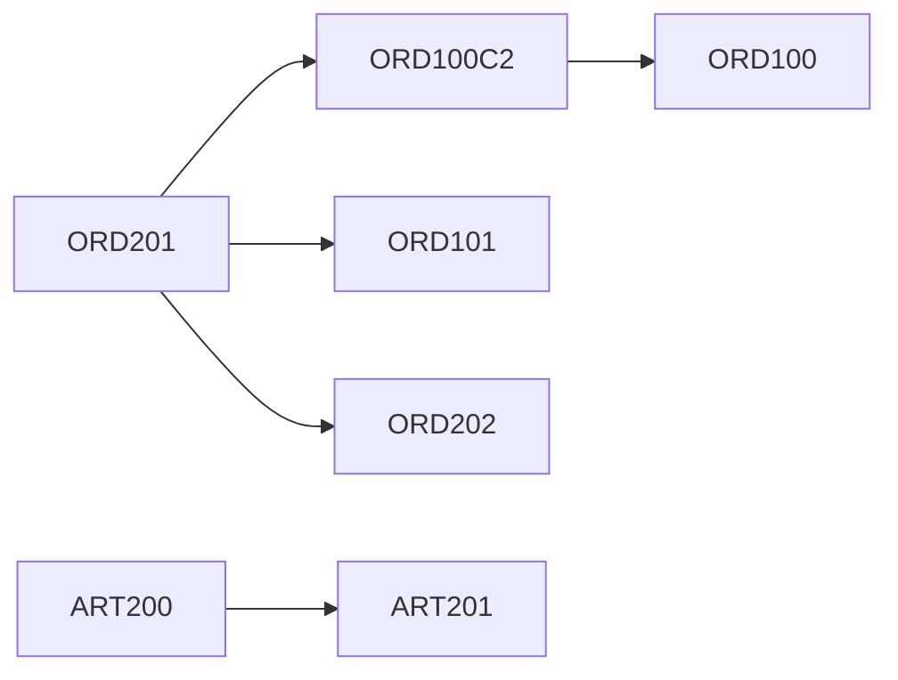

# Dependency diagrams

Confirmed call edges extracted from `CALL PGM` and `extpgm` where the callee source exists:

`ORD100`, `ORD101`, `ORD200`, and `ORD201` also name `ORD500`. That edge is Confirmed Missing in this checkout.
