# Application functional flows

The diagram quotes menu labels from `QPNLSRC/SAMMNU-Main_menu_application_SAMPLE.MENUSRC`. An arrow means the menu source names that option. It does not prove the called program completes.

```mermaid
flowchart TD
  menu["SAMMNU"]
  o1["1 Work with Articles"]
  menu --> o1
  o2["2 Work with Customers"]
  menu --> o2
  o3["3 Work with Customer Orders"]
  menu --> o3
  o4["4 Work with Providers"]
  menu --> o4
  o5["5 Display Providers"]
  menu --> o5
  o6["6 Create a Customer Order."]
  menu --> o6
  o10["10 Article to purchase"]
  menu --> o10
  o11["11 cmd STRQMQRY QMQRY(ARTQRY) "]
  menu --> o11
  o12["12 cmd call par200"]
  menu --> o12
  o20["20 Work with Parameters"]
  menu --> o20
  o21["21 Work with countries"]
  menu --> o21
  o80["80 Reset LASTORDNO"]
  menu --> o80
  o81["81 Reset Order dates to current"]
  menu --> o81
  o82["82 Work with IFS output"]
  menu --> o82
  o83["83 Work with IFS output"]
  menu --> o83
  o84["84 Display Application log"]
  menu --> o84
  o90["90 Signoff"]
  menu --> o90
```

| Option | Group | Label | Action | Status | Resolved |
| --- | --- | --- | --- | --- | --- |
| 1 | Master files | Work with Articles | cmd call ART200 | Resolved | docs/application/programs/ART200-PGM.md |
| 2 | Master files | Work with Customers | cmd call CUS200 | Confirmed Missing |  |
| 3 | Master files | Work with Customer Orders | cmd call ORD201 | Resolved | docs/application/programs/ORD201-PGM.md |
| 4 | Master files | Work with Providers | cmd call pro200 | Resolved | docs/application/modules/PRO200-MODULE.md |
| 5 | Master files | Display Providers | cmd call pro201 | Resolved | docs/application/modules/PRO201-MODULE.md |
| 6 | Master files | Create a Customer Order. | cmd call ORD100C2 | Resolved | docs/application/programs/ORD100C2-PGM.md |
| 10 | Reports | Article to purchase | cmd call pro203 | Confirmed Missing |  |
| 11 | Reports |  | cmd STRQMQRY QMQRY(ARTQRY)  | Unresolved |  |
| 12 | Reports |  | cmd call par200 | Resolved | docs/application/modules/PAR200-MODULE.md |
| 20 | Utilities | Work with Parameters | cmd call par200 | Resolved | docs/application/modules/PAR200-MODULE.md |
| 21 | Utilities | Work with countries | cmd call cou200 | Resolved | docs/application/programs/COU200-PGM.md |
| 80 | Utilities | Reset LASTORDNO | cmd call ord900 | Resolved | docs/application/programs/ORD900-PGM.md |
| 81 | Utilities | Reset Order dates to current | cmd call ord901 | Resolved | docs/application/programs/ORD901-PGM.md |
| 82 | Utilities | Work with IFS output | cmd call par201 | Resolved | docs/application/modules/PAR201-MODULE.md |
| 83 | Utilities | Work with IFS output | cmd call par201 | Resolved | docs/application/modules/PAR201-MODULE.md |
| 84 | Utilities | Display Application log | cmd adspusrspc samlog | Unresolved |  |
| 90 | Utilities | Signoff | cmd signoff | Unresolved |  |

Option 6 is Confirmed one step further: `QCLSRC/ORD100C2.PGM.CLLE` contains `CALL PGM(ORD100)`.
