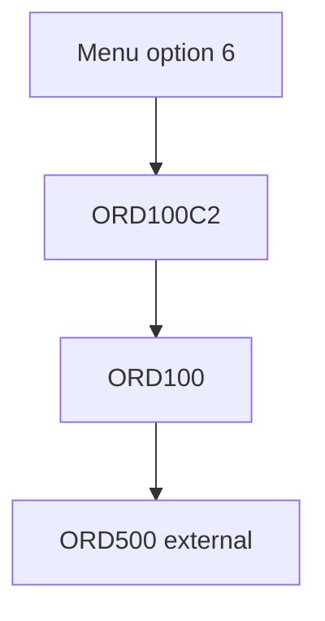

# Program processing flows

Confirmed path:

`QCLSRC/ORD100C2.PGM.CLLE` deletes `QTEMP/DETORD`, duplicates `DETORD` into `QTEMP`, overrides `TMPDETORD`, and calls `ORD100`. `QRPGLESRC/ORD100.PGM.RPGLE` declares `ORDER`, `DETORD`, `TMPDETORD`, and `ORD100D`, and prototypes `ORD500` with `extpgm`. What `ORD500` does is Unresolved.

Other programs list subroutines in source order on their specification pages. That order is not an execution trace.
